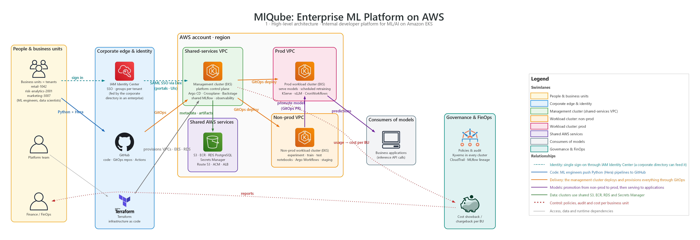
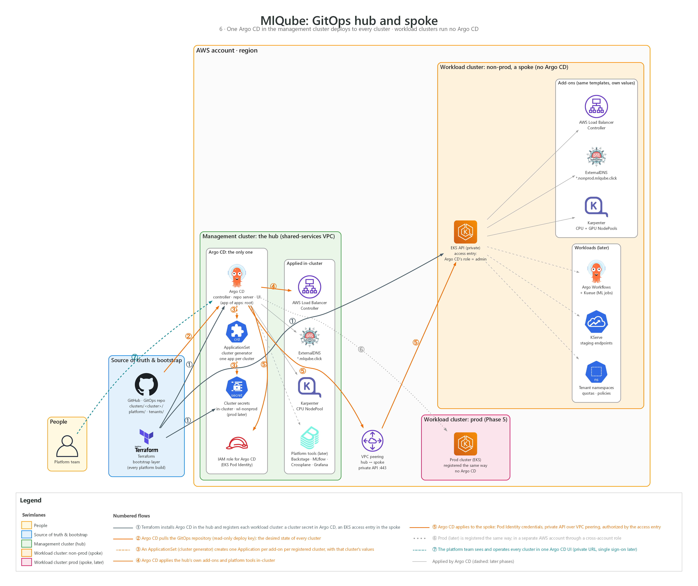

# mlqube/.github

This is the special `.github` repository for the **MlQube** organization.

- [`profile/README.md`](profile/README.md) is shown on the organization's GitHub page.
- [`docs/`](docs/) describes the idea behind MlQube: a Kubernetes-native internal developer platform (IDP) for ML/AI teams.

| Document | Purpose |
|---|---|
| [Why an ML platform?](docs/why-an-ml-idp.md) | The business case: problems without one, value for each stakeholder, results to measure |
| [Vision](docs/vision.md) | The problem, who it's for, goals and non-goals |
| [Architecture](docs/architecture.md) | Platform layers, components and tenancy model |
| [Roadmap](docs/roadmap.md) | Phased delivery plan and exit criteria |
| [Phase 1 plan](docs/phase-1-plan.md) | Task checklist for the AWS foundation and the Kueue spike |
| [Platform documentation](docs/platform/README.md) | How the platform is built, run and debugged: setup, secrets, troubleshooting, and one page per Terraform layer, module and GitOps add-on, with diagrams (docs for the `infrastructure` and `gitops` repositories) |
| [ADRs](docs/adr/README.md) | Architecture decisions: AWS/EKS, cluster topology, Argo Workflows, tenancy and more |

## Architecture at a glance

📐 **Main architecture diagram:** [full enterprise view (PNG)](docs/diagrams/mlqube_5_enterprise.png) · [SVG](docs/diagrams/mlqube_5_enterprise.svg). The diagram above is the high-level view; the [architecture document](docs/architecture.md#enterprise-view) walks through all six views step by step.

MlQube is an internal developer platform for ML/AI on Kubernetes, used by one organization. It **assembles proven open-source components** and adds a thin MlQube glue layer for tenancy, golden paths and cost. What is planned:

- **Cloud and infrastructure:** AWS and Amazon EKS, provisioned with Terraform. One VPC per environment, private subnets only.
- **Hub-and-spoke clusters:**
  - **Management cluster** (the control plane, no tenant workloads): Argo CD as the GitOps hub, Crossplane for the platform APIs, Backstage as the developer portal, one shared MLflow, and central observability (Prometheus, Grafana, Loki, OpenTelemetry, OpenCost).
  - **Non-prod workload cluster:** notebooks, ML jobs written in Python with the Hera SDK and run by Argo Workflows, GPU queues per tenant with Kueue, staging endpoints.
  - **Prod workload cluster:** KServe endpoints (vLLM for LLMs) with canary rollouts, and production pipelines such as scheduled retraining.
  - **Karpenter NodePools** in each workload cluster: CPU, gVisor-sandboxed CPU, GPU dedicated per tenant (spot for training) and GPU inference.
- **Tenancy:** each business unit is a tenant, named `<businessunit_name>-<businessunitid>` (e.g. `retail-1042`). All tenants share the clusters in one tier, isolated with Capsule namespaces, quotas, default-deny network policies, Kyverno and a per-tenant IAM role through EKS Pod Identity.
- **Identity:** single sign-on through **AWS IAM Identity Center**, the identity hub; in an organization the corporate directory (e.g. Entra ID or Okta) feeds it. Tools sign people in with SAML (through Dex where needed); `kubectl` goes through Identity Center roles and EKS access entries. Groups per tenant (`mlqube-<tenant>-admins`, `-developers`, `-viewers`) decide what each person can do. Workloads never use static cloud keys.
- **Platform APIs:** `Tenant`, `MLProject`, `Workspace` and `ModelDeployment`, requested through Backstage and reconciled by Crossplane into S3 buckets, IAM roles, ECR repositories and namespaces.
- **Model lifecycle:** develop in a notebook → train on a tenant GPU node → track and register in MLflow (metadata in RDS PostgreSQL, artifacts in S3 under a prefix per tenant) → test on a staging endpoint → promote through a GitOps PR → Argo CD rolls out a KServe canary in prod.
- **Shared AWS services:** S3, ECR, RDS PostgreSQL (Multi-AZ), Secrets Manager (through External Secrets), Route 53, ACM and the AWS Load Balancer Controller.
- **Governance and FinOps:** Kyverno policies in every cluster, audit and lineage, and showback/chargeback per business unit with OpenCost.

| View | Shows |
|---|---|
| [1. High-level architecture](docs/diagrams/mlqube_1_overview.png) | The building blocks and how they relate |
| [2. Identity](docs/diagrams/mlqube_2_identity.png) | How people are authenticated and authorized, and how workloads get cloud access |
| [3. Management cluster and shared services](docs/diagrams/mlqube_3_management.png) | What runs in the management cluster and how it uses the shared AWS services |
| [4. Training, testing and serving](docs/diagrams/mlqube_4_ml_lifecycle.png) | One model's path from Python code to a canary in prod |
| [5. Full view](docs/diagrams/mlqube_5_enterprise.png) | All parts joined together |
| [6. GitOps hub and spoke](docs/diagrams/mlqube_6_gitops_hub.png) | One Argo CD in the management cluster deploys to every cluster; workload clusters run no Argo CD |

## GitOps: hub and spoke

**One Argo CD, in the management cluster**, deploys to every cluster. The workload clusters run **no Argo CD**: Terraform registers each one with the hub (a cluster secret in Argo CD, and an EKS access entry for Argo CD's IAM role in the spoke), and Argo CD applies to them over private networking. An ApplicationSet gives every registered cluster the shared add-ons with its own values. If the hub is down, the workload clusters keep running; only changes pause. The flows, and why one hub rather than an Argo CD per cluster, are in the [architecture document](docs/architecture.md#6-gitops-hub-and-spoke).

Decisions behind this design are recorded in the [ADRs](docs/adr/README.md).

## Contributing

MlQube is in the planning phase. To propose an idea or challenge a decision, open an issue. To propose an architectural decision, add an ADR using [the template](docs/adr/0000-template.md).
