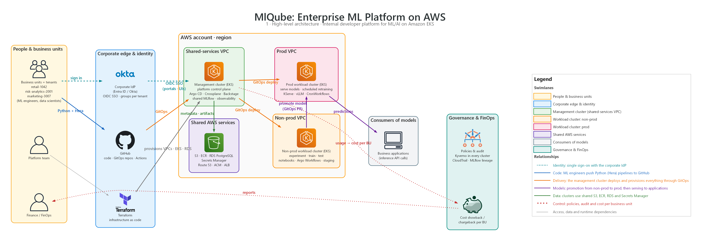
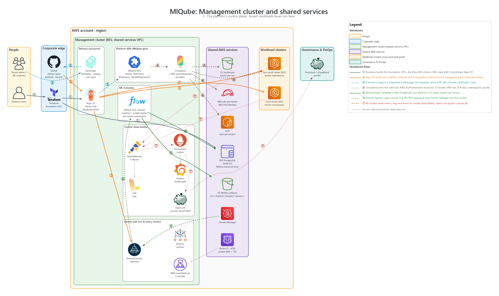
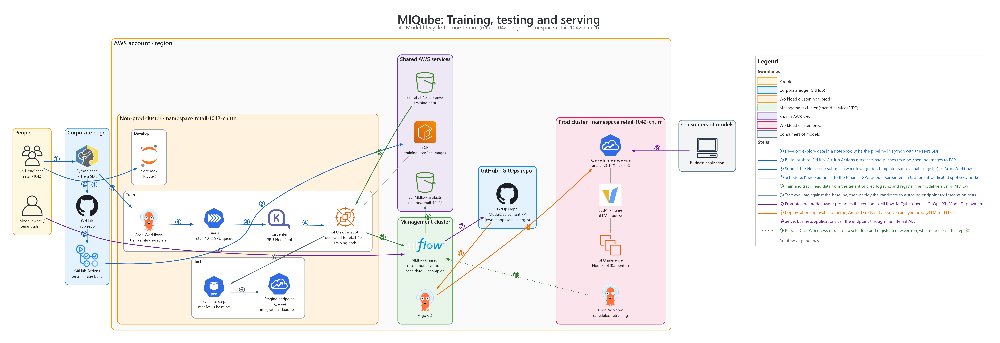
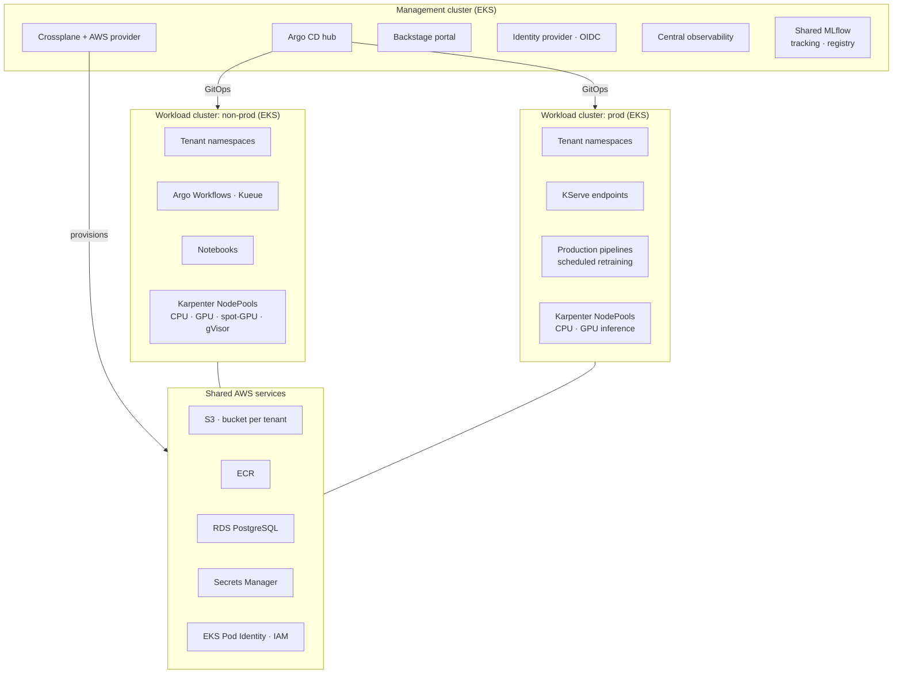
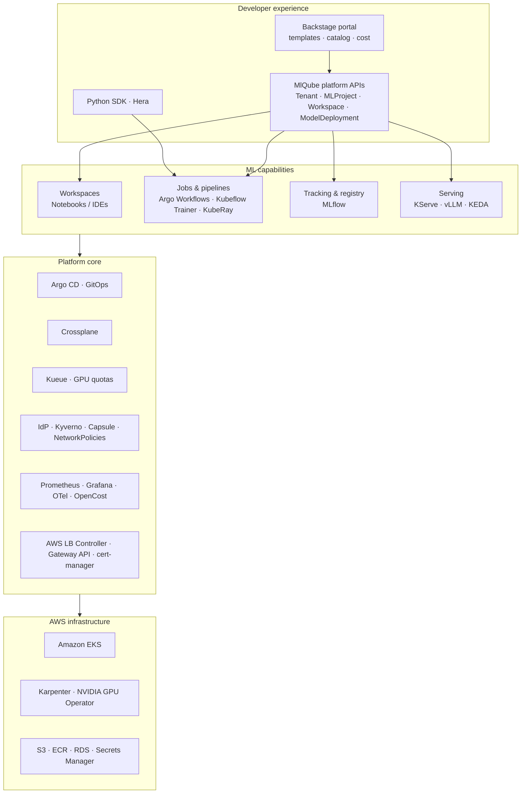
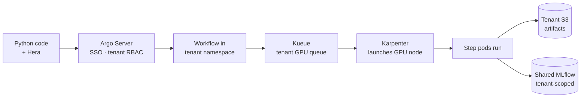
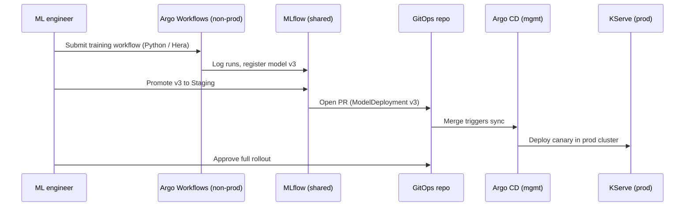

# Architecture

> Decisions are recorded in [ADRs](adr/); open items are listed at the end of this page.

## Key decisions

| Area | Decision | ADR | Status |
|---|---|---|---|
| Approach | Assemble open-source components plus a thin MlQube glue layer | [0001](adr/0001-assemble-open-source-components.md) | Accepted |
| Cloud | AWS / Amazon EKS first | [0002](adr/0002-aws-eks-as-first-cloud.md) | Accepted |
| Topology | Management cluster plus workload clusters (non-prod, prod) | [0003](adr/0003-cluster-topology.md) | Accepted |
| Tenancy | Single tier: each business unit is a tenant (`<businessunit_name>-<businessunitid>`) on the shared clusters | [0004](adr/0004-tenancy-model.md) | Accepted |
| ML jobs & pipelines | Argo Workflows with the Hera Python SDK | [0005](adr/0005-argo-workflows-with-hera-for-ml-jobs.md) | Accepted |
| Platform APIs | Crossplane | [0006](adr/0006-platform-apis-with-crossplane.md) | Accepted |
| Tracking & registry | One shared MLflow (RDS PostgreSQL + S3), isolated by permissions and S3 prefixes | [0007](adr/0007-mlflow-multi-tenancy.md) | Accepted |
| Untrusted code | gVisor for CPU workloads, tenant-dedicated GPU nodes | [0008](adr/0008-workload-sandboxing.md) | Accepted |

## Enterprise view

The architecture is shown in five views, from the big picture down to the details. Every view reads left to right and uses the same swimlane colours. Click an image for the scalable SVG. The sources are in [`diagrams/`](diagrams/) (Python `diagrams` library + Graphviz); `python docs/diagrams/render_all.py` re-renders all of them.

### 1. High-level architecture

[](diagrams/mlqube_1_overview.svg)

Business units (tenants) sign in through the corporate IdP and push Python (Hera) code to GitHub. The **management cluster** is the platform's control plane: it deploys and provisions everything through GitOps. ML work happens in the **non-prod workload cluster**; promoted models are served from the **prod workload cluster** to business applications. All clusters use the shared AWS services, and the platform reports policy, audit and cost per business unit.

### 2. Identity, authentication and authorization

[](diagrams/mlqube_2_identity.svg)

1. Users reach the portals over the corporate network / VPN, through a private ALB with TLS certificates from ACM.
2. Each tool (Backstage, MLflow, Grafana, Argo CD, Argo Workflows) signs the user in with the corporate IdP (OIDC + MFA). The ID token carries the user's groups: `mlqube-<tenant>-admins`, `-developers`, `-viewers`.
3. Each tool maps those groups to roles in the user's own tenant only: Backstage ownership, MLflow permissions on the tenant's experiments and models, Grafana teams, Argo Workflows SSO RBAC.
4. `kubectl` uses the same OIDC token against the EKS API; Kubernetes RBAC and Capsule limit users to their tenant's namespaces.
5. Kyverno and Capsule check every object at admission (tenant labels, quotas, allowed images).
6. Workloads never hold static cloud keys: a tenant pod's ServiceAccount gets temporary credentials for the tenant's IAM role through EKS Pod Identity, which can reach only that tenant's S3 bucket, ECR repositories and secrets.

### 3. Management cluster and shared services

[](diagrams/mlqube_3_management.svg)

The management cluster runs the platform itself; tenant workloads never run there. It contains: **Argo CD** (GitOps hub), **Backstage** (portal: templates, catalog, cost views), **Crossplane** with the MlQube APIs (`Tenant`, `MLProject`, `Workspace`, `ModelDeployment`), the one shared **MLflow**, **central observability** (OpenTelemetry Collector, Prometheus, Loki, Grafana, OpenCost) and the add-ons every cluster has (External Secrets Operator, AWS Load Balancer Controller, Kyverno).

1. Terraform builds the foundation (VPCs, the three EKS clusters, RDS, base IAM) and bootstraps Argo CD.
2. Argo CD syncs platform add-ons and configuration from Git to the management and workload clusters.
3. A new tenant or project is requested in Backstage; the template opens a PR with a `Tenant` / `MLProject` claim, which Argo CD applies.
4. Crossplane turns the claim into AWS and Kubernetes resources: S3 bucket, IAM role, ECR repository, namespaces, quotas and Kueue queues.
5. MLflow keeps metadata in RDS PostgreSQL (Multi-AZ) and artifacts in S3 under a prefix per tenant.
6. External Secrets copies secrets (e.g. the RDS password) from Secrets Manager into the clusters.
7. All clusters send metrics, logs and traces to central observability; OpenCost reports cost per business unit.

### 4. Training, testing and serving

[](diagrams/mlqube_4_ml_lifecycle.svg)

1. **Develop:** explore data in a notebook and write the pipeline in Python with the Hera SDK.
2. **Build:** push to GitHub; GitHub Actions runs tests and pushes training and serving images to ECR.
3. **Submit:** the Hera code submits a workflow (golden template `train-evaluate-register`) to Argo Workflows in the tenant's namespace.
4. **Schedule:** Kueue admits it to the tenant's GPU queue; Karpenter starts a tenant-dedicated spot GPU node.
5. **Train and track:** the job reads data from the tenant's S3 bucket, logs runs and registers the model version in MLflow.
6. **Test:** an evaluate step compares the model against the baseline, then the candidate is deployed to a staging endpoint (KServe) for integration and load tests.
7. **Promote:** the model owner promotes the version in MLflow; MlQube opens a GitOps PR with a `ModelDeployment`.
8. **Deploy:** after approval and merge, Argo CD rolls out a KServe canary in prod (vLLM for LLMs) on GPU inference nodes.
9. **Serve:** business applications call the endpoint through the internal ALB.
10. **Retrain:** CronWorkflows retrain on a schedule and register a new version, which goes back to step 6.

### 5. Full view

[](diagrams/mlqube_5_enterprise.svg)

All parts joined together: **people and business units** (tenants such as `retail-1042`, `risk-analytics-2001` and `marketing-3007`, plus the platform team and Finance/FinOps), the **corporate edge and identity** (corporate IdP, VPN, GitHub org, Terraform), the **AWS account** (management cluster, non-prod and prod workload clusters, shared AWS services), and **governance and FinOps**.

Numbered flows:

1. **Job submission:** an ML engineer writes Python with the Hera SDK and submits it to Argo Workflows; Kueue admits it to the tenant's GPU queue and Karpenter launches a tenant-dedicated GPU node (spot for training).
2. **Tracking and registry:** the job logs runs and registers the model in the shared MLflow; metadata goes to RDS PostgreSQL (Multi-AZ), artifacts to the tenant's S3 prefix (`s3://<bucket>/tenants/<tenant>/`).
3. **Model promotion:** promoting a model in MLflow opens a GitOps PR in GitHub; on merge, Argo CD deploys a KServe canary (vLLM for LLMs) in the prod cluster.
4. **GitOps:** Argo CD in the management cluster syncs both workload clusters.
5. **Provisioning:** Crossplane creates each tenant's S3 bucket, IAM role (EKS Pod Identity) and namespaces.
6. **SSO:** the corporate IdP (OIDC) signs users in to Backstage, the Argo Workflows UI and MLflow, using the groups `mlqube-<tenant>-admins`, `-developers` and `-viewers`.
7. **Metrics and cost:** all clusters send metrics and logs to central observability (OpenTelemetry, Prometheus, Loki, Grafana); OpenCost turns them into a showback/chargeback report per BU.

## Cluster topology on AWS



- **Management cluster:** runs the platform itself. Tenant workloads never run here.
- **Non-prod workload cluster:** experimentation, jobs, notebooks, MLflow and staging endpoints.
- **Prod workload cluster:** production endpoints and production pipelines.
- **Local development:** a single kind cluster plays all roles.

## Layered view



## Layers

| Layer | Components | Responsibility |
|---|---|---|
| **Infrastructure** | Terraform, Amazon EKS, VPC per environment, Karpenter NodePools (CPU, GPU, spot-GPU, inference, gVisor), NVIDIA GPU Operator, S3, ECR, RDS | Reproducible clusters and elastic GPU capacity |
| **Platform core** | Argo CD (hub in mgmt cluster), Crossplane (AWS + Kubernetes providers), AWS Load Balancer Controller / Gateway API, cert-manager, External Secrets (Secrets Manager), Kyverno | Declarative delivery, cloud resources, ingress, secrets, policy |
| **Tenancy & identity** | OIDC identity provider (Keycloak or corporate IdP), Capsule, NetworkPolicies, Kueue, EKS Pod Identity | Tenant isolation, authentication, RBAC, GPU fair-share, IAM without static keys |
| **Workspaces** | Kubeflow Notebooks or Coder, curated CUDA/framework images | Self-service development environments |
| **Jobs & pipelines** | **Argo Workflows + Hera**, golden-path ClusterWorkflowTemplates, CronWorkflows, Kubeflow Trainer / KubeRay for distributed training | Run Python ML code as jobs and pipelines |
| **Tracking & registry** | One shared MLflow: RDS PostgreSQL backend store, S3 artifact store with a prefix per tenant, OIDC SSO, per-tenant permissions | Experiments, model versions, stage promotion |
| **Serving** | KServe (vLLM, Triton, sklearn/xgboost runtimes), KEDA / Knative | Autoscaled inference endpoints, canary rollouts |
| **CI/CD** | GitHub Actions → ECR, Argo CD, Argo Rollouts | Image builds, model promotion through GitOps |
| **Portal** | Backstage | Templates, model & endpoint catalog, usage and cost views |
| **Observability & cost** | Prometheus, Grafana, Loki, OpenTelemetry, DCGM exporter, OpenCost (AWS pricing) | Metrics, logs, traces, GPU telemetry, cost allocation |

## How ML engineers run code

ML engineers write **Python** and submit it as an **Argo Workflow** using the Hera SDK ([ADR-0005](adr/0005-argo-workflows-with-hera-for-ml-jobs.md)):

```python
from hera.workflows import Workflow, script, Resources

@script(image="mlqube/pytorch:cuda", resources=Resources(gpus=1, memory="32Gi"))
def train(lr: float):
    ...  # regular PyTorch / scikit-learn code, logging to MLflow

with Workflow(generate_name="train-", entrypoint="train", namespace="team-a") as w:
    train(arguments={"lr": 0.001})
w.create()
```



- **Golden-path templates:** `train-evaluate-register`, `batch-inference`, `hyperparameter-sweep`.
- **Distributed training:** a step creates a Kubeflow `TrainJob` or Ray job and waits for it.
- **Scheduled jobs:** CronWorkflows, e.g. nightly retraining.

## Platform APIs (the glue layer)

MlQube adds a small set of high-level resources, implemented with Crossplane ([ADR-0006](adr/0006-platform-apis-with-crossplane.md)):

| Resource | Expands into |
|---|---|
| `Tenant` | Capsule tenant, quotas, Kueue queue, network policies, S3 bucket, IAM role, MLflow permissions and S3 artifact prefix |
| `MLProject` | Project namespace, ECR repository, CI configuration, MLflow experiment, starter WorkflowTemplates |
| `Workspace` | Notebook/IDE instance with GPU limits and storage |
| `ModelDeployment` | KServe InferenceService, route, autoscaling, canary policy, dashboards |

Users normally create these through Backstage. Advanced users can apply them directly through Git.

## Multi-tenancy model

MlQube serves one organization, and **each business unit (BU) is a tenant**. All tenants share the same clusters in a single tier.

- **Tenant ID:** `<businessunit_name>-<businessunitid>`, e.g. `retail-1042`. The BU ID is numeric. Lowercase, at most 30 characters, and immutable once created.
- **Used everywhere:** Capsule tenant, namespaces (`retail-1042-churn`), the `mlqube/tenant` label, Kueue queue, IdP groups, IAM role, S3 bucket, MLflow names and prefixes, and cost reports.
- **Isolation:** Capsule namespaces, quotas, Kueue fair-share, default-deny network policies, Kyverno, IAM per tenant, gVisor for CPU workloads and tenant-dedicated GPU nodes.
- **Cost:** showback/chargeback per BU, based on the tenant label.

See [ADR-0004](adr/0004-tenancy-model.md) and [ADR-0008](adr/0008-workload-sandboxing.md).

## Model lifecycle flow



## Open questions

1. Identity provider: self-hosted Keycloak, Amazon Cognito, or the organization's corporate IdP (e.g. Entra ID, Okta) through federation
2. Ingress: AWS Load Balancer Controller only, or Gateway API with Envoy Gateway / Istio
3. Observability: self-hosted, or Amazon Managed Prometheus/Grafana
4. Kueue with Argo Workflow pods: to be checked in a Phase 1 spike
5. Workspaces: Kubeflow Notebooks or Coder
