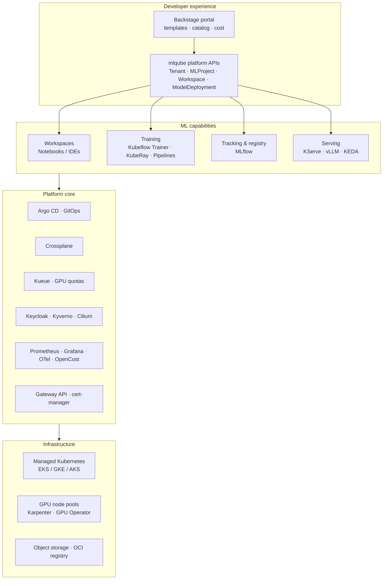
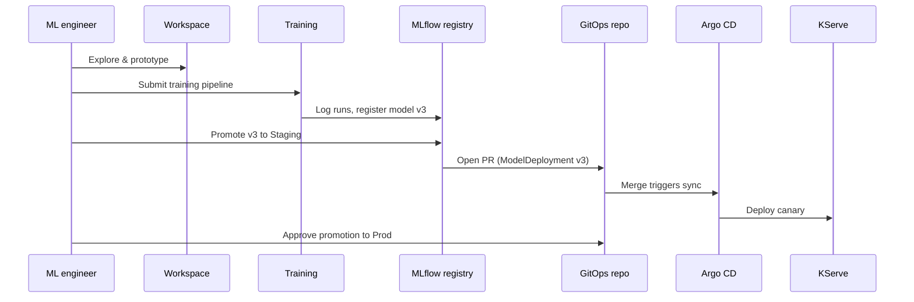

# Architecture

> Draft. Components and choices may change as [ADRs](adr/) are accepted.

## Layered view

## Layers

| Layer | Components | Responsibility |
|---|---|---|
| **Infrastructure** | OpenTofu/Terraform, managed Kubernetes, Karpenter or node auto-provisioning, NVIDIA GPU Operator, object storage, OCI registry | Reproducible clusters and elastic GPU capacity |
| **Platform core** | Argo CD, Crossplane, Gateway API (Envoy Gateway / Istio), cert-manager, External Secrets, Kyverno | Declarative delivery, cloud resources, ingress, secrets, policy |
| **Tenancy & identity** | Keycloak or cloud IdP (OIDC), Capsule / vCluster, Cilium network policies, Kueue | Tenant isolation, authentication, RBAC, GPU fair-share |
| **Workspaces** | Kubeflow Notebooks or Coder, curated CUDA/framework images | Self-service development environments |
| **Training** | Kubeflow Trainer, KubeRay, Kubeflow Pipelines or Argo Workflows | Distributed training and ML pipelines |
| **Tracking & registry** | MLflow, per-tenant artifact buckets | Experiments, model versions, stage promotion |
| **Serving** | KServe (vLLM, Triton, sklearn/xgboost runtimes), KEDA / Knative | Autoscaled inference endpoints, canary rollouts |
| **CI/CD** | GitHub Actions or Tekton, Argo CD, Argo Rollouts | Image builds, model promotion through GitOps |
| **Portal** | Backstage | Templates, model & endpoint catalog, usage and cost views |
| **Observability & cost** | Prometheus, Grafana, Loki, OpenTelemetry, DCGM exporter, OpenCost | Metrics, logs, traces, GPU telemetry, cost allocation |

## Platform APIs (the glue layer)

mlqube adds a small set of high-level resources, implemented as Crossplane Compositions or KRO definitions:

| Resource | Expands into |
|---|---|
| `Tenant` | Namespaces, quotas, Kueue queues, network policies, IdP group, artifact bucket, MLflow access |
| `MLProject` | Git repo from template, CI pipeline, project namespace, MLflow experiment |
| `Workspace` | Notebook/IDE instance with GPU limits and storage |
| `ModelDeployment` | KServe InferenceService, route, autoscaling, canary policy, dashboards |

Users normally create these through Backstage. Advanced users can apply them directly through Git.

## Multi-tenancy model (proposed)

| Tier | Isolation | Use case |
|---|---|---|
| **Standard** | Shared cluster; namespace per tenant (Capsule), network policies, Kueue quotas, optional sandboxed runtime (gVisor/Kata) | Cost-efficient default |
| **Premium** | Virtual cluster per tenant (vCluster) on shared nodes or dedicated node pools | Teams that need their own control plane |
| **Enterprise** | Dedicated cluster per tenant | Strict compliance or data residency |

Key isolation concerns: shared GPU nodes, secrets, MLflow authorization, egress control and untrusted code in notebooks and training jobs.

## Model lifecycle flow

## Open questions

These will be settled as ADRs:

1. Which cloud provider comes first?
2. Final tenancy tiers and default isolation for the shared tier
3. Kubeflow Pipelines vs Argo Workflows
4. MLflow multi-tenancy: an instance per tenant or shared behind an authorization proxy
5. Crossplane Compositions vs KRO for the platform APIs
6. Whether sandboxed runtimes are required for the shared tier
