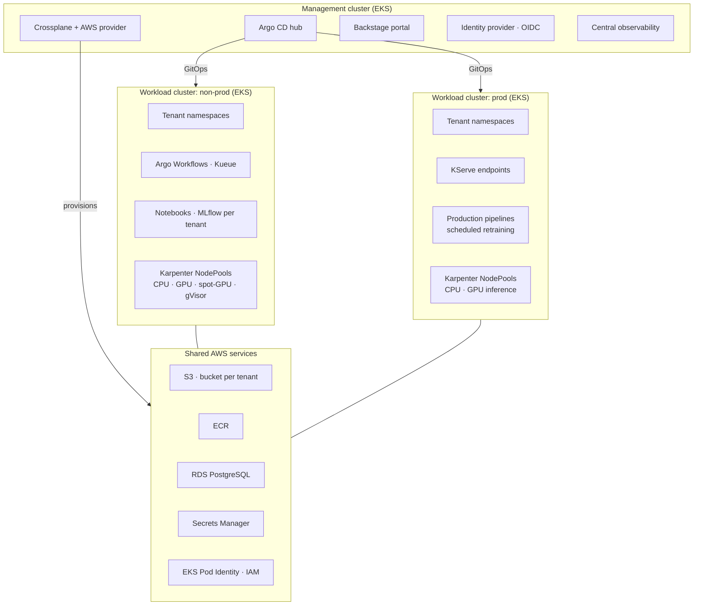
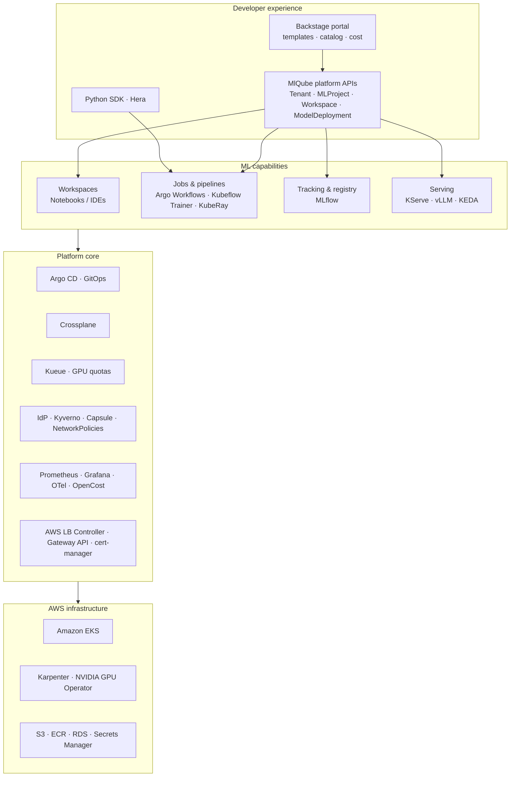
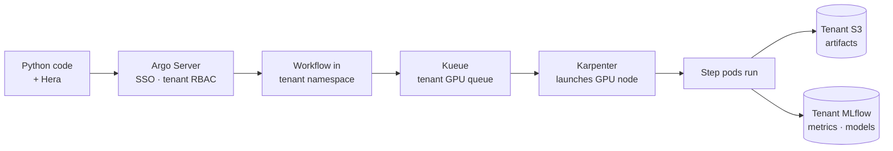

# Architecture

> Draft. Decisions are recorded in [ADRs](adr/); open items are listed at the end of this page.

## Key decisions

| Area | Decision | ADR | Status |
|---|---|---|---|
| Approach | Assemble open-source components plus a thin MlQube glue layer | [0001](adr/0001-assemble-open-source-components.md) | Accepted |
| Cloud | AWS / Amazon EKS first | [0002](adr/0002-aws-eks-as-first-cloud.md) | Accepted |
| Topology | Management cluster plus workload clusters (non-prod, prod) | [0003](adr/0003-cluster-topology.md) | Accepted |
| Tenancy | Tiers: Capsule namespaces, then vCluster, then dedicated cluster | [0004](adr/0004-tenancy-model.md) | Proposed |
| ML jobs & pipelines | Argo Workflows with the Hera Python SDK | [0005](adr/0005-argo-workflows-with-hera-for-ml-jobs.md) | Accepted |
| Platform APIs | Crossplane | [0006](adr/0006-platform-apis-with-crossplane.md) | Proposed |
| Tracking & registry | One MLflow instance per tenant | [0007](adr/0007-mlflow-multi-tenancy.md) | Proposed |
| Untrusted code | gVisor for CPU workloads, tenant-dedicated GPU nodes | [0008](adr/0008-workload-sandboxing.md) | Proposed |

## Cluster topology on AWS



- **Management cluster:** runs the platform itself. Tenant workloads never run here.
- **Non-prod workload cluster:** experimentation, jobs, notebooks, MLflow and staging endpoints.
- **Prod workload cluster:** production endpoints and production pipelines.
- **Enterprise tenants** get their own workload cluster, added as another spoke.
- **Local development:** a single kind cluster plays all roles.

## Layered view



## Layers

| Layer | Components | Responsibility |
|---|---|---|
| **Infrastructure** | Terraform, Amazon EKS, VPC per environment, Karpenter NodePools (CPU, GPU, spot-GPU, inference, gVisor), NVIDIA GPU Operator, S3, ECR, RDS | Reproducible clusters and elastic GPU capacity |
| **Platform core** | Argo CD (hub in mgmt cluster), Crossplane (AWS + Kubernetes providers), AWS Load Balancer Controller / Gateway API, cert-manager, External Secrets (Secrets Manager), Kyverno | Declarative delivery, cloud resources, ingress, secrets, policy |
| **Tenancy & identity** | OIDC identity provider (Keycloak or corporate IdP), Capsule / vCluster, NetworkPolicies, Kueue, EKS Pod Identity | Tenant isolation, authentication, RBAC, GPU fair-share, IAM without static keys |
| **Workspaces** | Kubeflow Notebooks or Coder, curated CUDA/framework images | Self-service development environments |
| **Jobs & pipelines** | **Argo Workflows + Hera**, golden-path ClusterWorkflowTemplates, CronWorkflows, Kubeflow Trainer / KubeRay for distributed training | Run Python ML code as jobs and pipelines |
| **Tracking & registry** | MLflow per tenant (RDS PostgreSQL metadata, S3 artifacts) | Experiments, model versions, stage promotion |
| **Serving** | KServe (vLLM, Triton, sklearn/xgboost runtimes), KEDA / Knative | Autoscaled inference endpoints, canary rollouts |
| **CI/CD** | GitHub Actions → ECR, Argo CD, Argo Rollouts | Image builds, model promotion through GitOps |
| **Portal** | Backstage | Templates, model & endpoint catalog, usage and cost views |
| **Observability & cost** | Prometheus, Grafana, Loki, OpenTelemetry, DCGM exporter, OpenCost (AWS pricing) | Metrics, logs, traces, GPU telemetry, cost allocation |

## How ML engineers run code

ML engineers write **Python** and submit it as an **Argo Workflow** using the Hera SDK ([ADR-0005](adr/0005-argo-workflows-with-hera-for-ml-jobs.md)):

```python
from hera.workflows import Workflow, script, Resources

@script(image="mlqube/pytorch:cuda", resources=Resources(gpus=1, memory="32Gi"))
def train(lr: float):
    ...  # regular PyTorch / scikit-learn code, logging to MLflow

with Workflow(generate_name="train-", entrypoint="train", namespace="team-a") as w:
    train(arguments={"lr": 0.001})
w.create()
```



- **Golden-path templates:** `train-evaluate-register`, `batch-inference`, `hyperparameter-sweep`.
- **Distributed training:** a step creates a Kubeflow `TrainJob` or Ray job and waits for it.
- **Scheduled jobs:** CronWorkflows, e.g. nightly retraining.

## Platform APIs (the glue layer)

MlQube adds a small set of high-level resources, implemented with Crossplane ([ADR-0006](adr/0006-platform-apis-with-crossplane.md)):

| Resource | Expands into |
|---|---|
| `Tenant` | Capsule tenant or vCluster, quotas, Kueue queue, network policies, S3 bucket, IAM role, MLflow instance |
| `MLProject` | Project namespace, ECR repository, CI configuration, MLflow experiment, starter WorkflowTemplates |
| `Workspace` | Notebook/IDE instance with GPU limits and storage |
| `ModelDeployment` | KServe InferenceService, route, autoscaling, canary policy, dashboards |

Users normally create these through Backstage. Advanced users can apply them directly through Git.

## Multi-tenancy model

| Tier | Isolation | Use case |
|---|---|---|
| **Standard** | Capsule tenant on shared workload clusters; quotas, Kueue, default-deny network policies, gVisor for CPU, tenant-dedicated GPU nodes | Cost-efficient default |
| **Premium** | vCluster per tenant, optionally with dedicated Karpenter NodePools | Teams that need their own control plane |
| **Enterprise** | Dedicated workload cluster | Strict compliance or data residency |

See [ADR-0004](adr/0004-tenancy-model.md) and [ADR-0008](adr/0008-workload-sandboxing.md).

## Model lifecycle flow


## Open questions

1. Identity provider: self-hosted Keycloak, Amazon Cognito, or the customer's own IdP through federation
2. Ingress: AWS Load Balancer Controller only, or Gateway API with Envoy Gateway / Istio
3. Observability: self-hosted, or Amazon Managed Prometheus/Grafana
4. Kueue with Argo Workflow pods: to be checked in a Phase 1 spike
5. Workspaces: Kubeflow Notebooks or Coder
