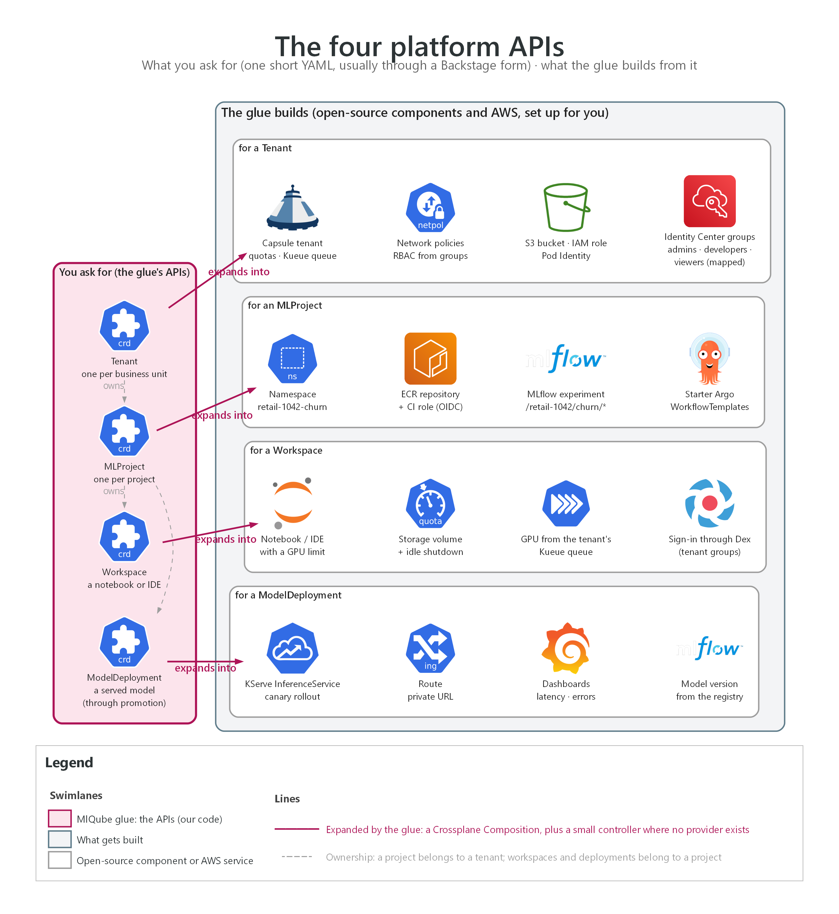

# The MlQube glue

> **Status:** 🧭 Designed, not built yet. The glue starts in Phase 2 with the `Tenant` API ([roadmap](roadmap.md)).

MlQube is assembled from open-source projects: Argo CD, Crossplane, Capsule, Kueue, Kyverno, Argo Workflows, MLflow, KServe, Backstage, OpenCost ([ADR-0001](adr/0001-assemble-open-source-components.md)). Each one does its own job well, and none of them knows about the others. Nothing out of the box says *"when business unit retail-1042 joins, give it a Capsule tenant, a GPU queue, an S3 bucket, an IAM role and its own MLflow experiments"*.

**The glue is the thin layer of our own code that says exactly that.** It's what turns ten separate tools into one platform. The name is the usual engineering word for code that connects existing parts: the parts are upstream, the glue is ours.

It is **not** a product, a CNCF project, a fork of anything, or a custom control plane. It is a handful of files (API definitions, templates, policies) and, where unavoidable, a small controller. Most of it runs on **Crossplane**, a CNCF project that many organizations use to build their own platform APIs: Crossplane is the engine, the glue is what we write for it.

## What the glue is


[SVG to zoom](diagrams/glue_1_overview.svg)

Magenta is our code; everything in a white box is upstream open source that we install, configure and upgrade, but don't write. The glue has five parts:

| Part | What it is | What it connects |
|---|---|---|
| **A · Backstage templates** | Software templates: "New tenant", "New ML project", "Deploy a model". Each turns a form into a short YAML file and opens a pull request | Backstage → GitHub (the `gitops` repository) |
| **B · Platform APIs** | Crossplane **XRDs** (the API's shape) and **Compositions** (the logic) for `Tenant`, `MLProject`, `Workspace`, `ModelDeployment` | Crossplane → Capsule, Kueue, Kubernetes, Argo Workflows, KServe, AWS |
| **C · MLflow permissions** | A Crossplane function or a small controller that grants a tenant's groups their experiments and models. MLflow has no Crossplane provider | Identity Center groups → MLflow ([ADR-0007](adr/0007-mlflow-multi-tenancy.md)) |
| **D · Kyverno policies** | Conventions as code: every object carries the `mlqube/tenant` label, names stay within the tenant's prefix, only allowed images run | Kyverno → every object in every cluster |
| **E · Metering** | The tenant label on everything, and the report rules that turn it into cost per business unit | OpenCost → business-unit admins |

The flow, as numbered in the picture: someone asks in Backstage (①); a glue template opens a pull request, which a person reviews (②); once merged, Argo CD applies it like everything else (③); Crossplane runs the glue's Composition (④), and the objects land in the components and AWS (⑤). Kyverno checks every one of them against the glue's policies (⑥), and the tenant label on all of them feeds a cost report per business unit (⑦).

## Crossplane and the glue: who writes what

| | Crossplane (upstream) | The glue (ours) |
|---|---|---|
| **What** | The engine: lets you define your own Kubernetes APIs and what they create | The APIs themselves: `Tenant`, `MLProject`, `Workspace`, `ModelDeployment` |
| **Pieces** | Core, **providers** (provider-aws for S3 and IAM, provider-kubernetes for objects in the workload clusters), **functions** (go-templating, auto-ready, …) | **XRDs** and **Compositions** written for MlQube, plus templates, policies and a small controller |
| **Who maintains it** | The Crossplane community (CNCF) | The MlQube platform team |
| **Installed how** | Helm chart, by Argo CD, like every other add-on | Plain YAML in the `gitops` repository, applied by Argo CD |
| **Upgraded how** | Pinned chart version, upgraded like any add-on | Versioned APIs (`v1alpha1`, `v1beta1`, …), changed by pull request |

Every company that builds an internal platform writes its own version of this layer: it's what makes the platform *theirs*. There is no shared "glue" to download.

## How one request becomes a tenant


[SVG to zoom](diagrams/glue_2_tenant.svg)

What a business-unit admin (or the Backstage template) commits is short:

```yaml
# gitops: tenants/retail-1042.yaml
apiVersion: platform.mlqube.click/v1alpha1
kind: Tenant
metadata:
  name: retail-1042          # <businessunit_name>-<businessunitid>, at most 30 characters
spec:
  gpuQuota: 4
  groups:                    # Identity Center group IDs (ADR-0015)
    admins: <group-id>
    developers: <group-id>
    viewers: <group-id>
```

Three pieces of Crossplane turn it into everything else:

| Piece | Kind | Role | Ours? |
|---|---|---|---|
| **XRD** (CompositeResourceDefinition) | The schema | Defines the `Tenant` API: which fields exist, which are required, what's valid (for example the tenant ID format). Kubernetes rejects anything else | ✅ glue |
| **Composition** | The logic | A pipeline of Crossplane functions that, from one `Tenant`, renders every object it implies and reports when they're all ready | ✅ glue |
| **Composite resource (XR)** | The request | The `Tenant retail-1042` object itself. Crossplane watches it, runs the Composition, and keeps the created objects in line with it | The request (written by a person or a template) |

**Crossplane v2:** older Crossplane (v1) had *claims*, namespaced requests pointing at cluster-wide composites. Crossplane v2 dropped them: you create the composite resource directly, cluster-wide (a `Tenant`, which creates namespaces) or in a namespace (an `MLProject`, in its tenant's namespace). MlQube starts on v2.

What a `Tenant` creates (the picture above):

| Where | Objects | Created by |
|---|---|---|
| **Workload clusters** | Capsule tenant (owners = the tenant's Identity Center groups), namespaces `retail-1042-*` with the `mlqube/tenant` label, ResourceQuota, Kueue ClusterQueue and LocalQueue (GPU quota, fair share), default-deny NetworkPolicy, a ServiceAccount for workloads, RoleBindings (developers: edit, viewers: view) | provider-kubernetes (Capsule then creates the namespaces and quotas) |
| **AWS** | S3 bucket `mlqube-tenant-retail-1042-<env>`, IAM role `mlqube-tenant-retail-1042` (only this tenant's bucket, ECR repositories `mlqube/tenants/retail-1042/*` and secrets; within the boundary `mlqube-boundary-tenant`), the Pod Identity association ServiceAccount → role, the secrets path `mlqube/tenants/retail-1042/*` | provider-aws |
| **MLflow** | Permissions on experiments `/retail-1042/*` and models `retail-1042.*` for the tenant's groups | The glue's MLflow function or controller |

When every object exists, the `Tenant` turns **Ready**, and Backstage shows it to whoever asked. Delete the file, and Crossplane removes what it created (with a deletion policy that keeps data, such as the S3 bucket, until someone decides otherwise).

## The four platform APIs



[SVG to zoom](diagrams/glue_3_apis.svg)

| API | Who asks | What the glue builds | Phase |
|---|---|---|---|
| `Tenant` | Platform team or business-unit admin | Capsule tenant, quotas, Kueue queue, network policies, RBAC from groups, S3 bucket, IAM role, Pod Identity, MLflow permissions | 2 |
| `MLProject` | ML engineers | Project namespace, ECR repository and CI role (GitHub OIDC), MLflow experiment, starter Argo WorkflowTemplates | 3–4 |
| `Workspace` | ML engineers | Notebook or IDE with a GPU limit, storage volume, idle shutdown, GPU from the tenant's Kueue queue, sign-in through Dex | 6 |
| `ModelDeployment` | ML engineers, through promotion in MLflow | KServe InferenceService with canary rollout, private route, dashboards, the model version from the registry | 5 |

A project belongs to a tenant; workspaces and deployments belong to a project. Users normally ask through Backstage; advanced users can write the YAML in Git directly. The same list is in the [architecture](architecture.md#platform-apis-the-glue-layer).

## Where the glue will live, and how it's tested

The Crossplane part of the glue sits next to Crossplane in the `gitops` repository, as **separate Argo CD apps**: the engine and its providers (upstream) and the glue (ours). It's the same split as cert-manager and its issuers, or External Secrets and its stores ([clusters/mgmt](platform/gitops/clusters-mgmt.md)):

```
gitops/
├── clusters/mgmt/crossplane/
│   ├── applicationset.yaml            # mgmt-crossplane: the engine (Helm chart)
│   ├── providers-applicationset.yaml  # mgmt-crossplane-providers: providers, functions, sign-in
│   └── glue-applicationset.yaml       # mgmt-crossplane-glue: our APIs (next)
└── platform/crossplane/
    ├── providers/              # provider-aws-*, provider-kubernetes, functions (pinned versions)
    └── glue/                   # XRDs + Compositions: Tenant, MLProject, Workspace, ModelDeployment
```

- **Different lifecycles.** The engine changes when its chart version is bumped; the glue changes with every API change. Separate Applications mean a broken Composition can't block an engine upgrade, and an engine upgrade doesn't redeploy the APIs.
- **Order.** The glue needs Crossplane's CRDs first, like the stores and issuers apps ([sync waves](https://github.com/mlqube/.github/issues/13)).
- **Clear ownership.** One folder is upstream, the other is ours.
- **mgmt only.** Crossplane runs in the hub and reaches the workload clusters through provider-kubernetes. Each app is an ApplicationSet with one element (`cluster: mgmt`), the convention for single-cluster add-ons: the root app may only create ApplicationSets. Details: [Crossplane](platform/gitops/crossplane.md).

The rest of the glue isn't Crossplane, so it lives with its own tool:

| Part | Where (planned) | Applied by |
|---|---|---|
| XRDs and Compositions (B) | `gitops` repository, `platform/crossplane/glue/` (app `mgmt-crossplane-glue`) | Argo CD |
| Kyverno policies (D) | `gitops` repository, next to the Kyverno policies already deployed ([Kyverno](platform/gitops/kyverno.md)) | Argo CD |
| Backstage templates (A) | The Backstage repository (golden path stage 3) | Backstage |
| MLflow permissions (C), if it's a controller | Its own small repository and image | Argo CD |
| Metering rules (E) | `gitops` repository, with OpenCost (observability, ADR-0012) | Argo CD |

Testing, without and with a cluster:

- **Without a cluster:** the Crossplane CLI renders a Composition from an example `Tenant` and validates the output against the schemas, in CI on every pull request. A broken Composition never reaches a cluster.
- **In a test build:** create two tenants and check that each got its objects, and that neither can see the other's workflows, data or network traffic (the Phase 2 exit criterion).

## Rules for the glue

- **Thin.** If an upstream project can do it, configure the project; write glue only for what connects them ([vision](vision.md)).
- **Declarative and in Git.** Every request is a YAML file in `gitops`, reviewed as a pull request and applied by Argo CD. The glue has no UI of its own and no database.
- **One tenant ID everywhere.** `<businessunit_name>-<businessunitid>`, lowercase, at most 30 characters, immutable ([architecture](architecture.md#multi-tenancy-model)). Every name the glue creates starts with it.
- **Versioned APIs.** The APIs start at `v1alpha1` and change by pull request; breaking changes get a new version.
- **Least privilege.** The IAM roles the glue creates allow only that tenant's resources; Crossplane's own AWS permissions are limited to the names it manages.

## Related

- [ADR-0001](adr/0001-assemble-open-source-components.md): assemble open source with a thin glue layer
- [ADR-0004](adr/0004-tenancy-model.md): business units as tenants
- [ADR-0006](adr/0006-platform-apis-with-crossplane.md): build the platform APIs with Crossplane
- [ADR-0007](adr/0007-mlflow-multi-tenancy.md): one shared MLflow, permissions granted by the glue
- [ADR-0015](adr/0015-iam-identity-center-identity-hub.md): Identity Center groups, sent as IDs
- [Architecture](architecture.md) · [Vision](vision.md) · [Roadmap](roadmap.md)

The pictures are drawn from code: `python docs/diagrams/glue_diagrams.py` (or `render_all.py` for every architecture view).
