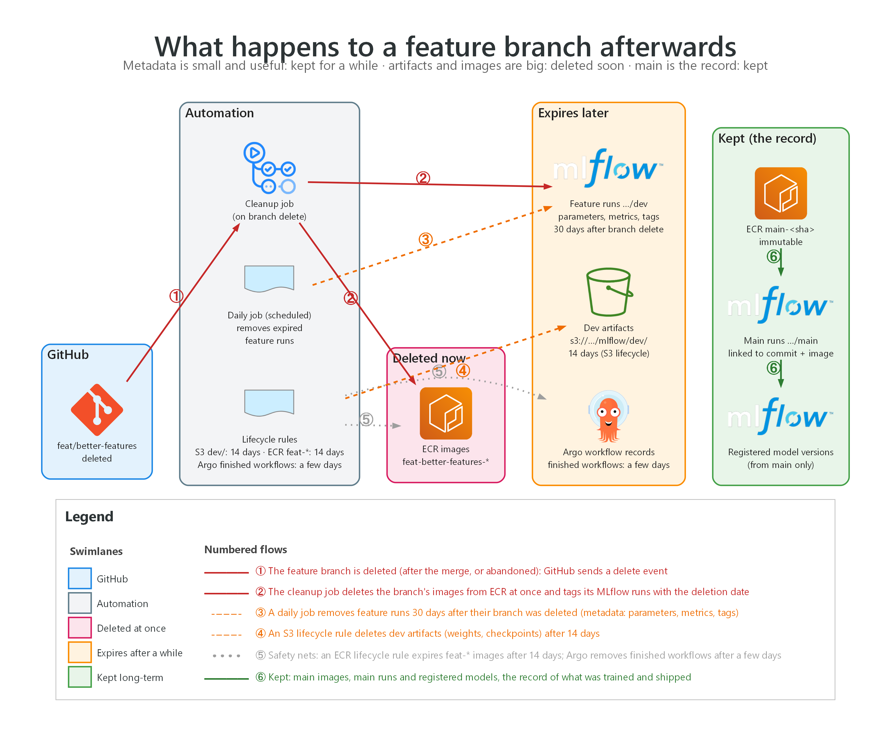

# The golden path: how an ML engineer works on MlQube

> **Status:** 🧭 Planned (golden path v0). The decisions are in [ADR-0016](adr/0016-golden-path-v0.md); the build steps in the [golden path v0 plan](golden-path-v0-plan.md). This page describes the process from the ML engineer's side, as it will work when v0 is built.

The golden path is the supported, paved way to go from an idea to a trained, registered model. You write Python; the platform builds, runs, tracks and cleans up. It follows **trunk-based development**:

- `main` is the only long-lived branch. Everything on it has been reviewed, and every merge makes an **official run** whose model can be promoted.
- You work on a short-lived **feature branch**. Every push starts **your own test run**, on a GPU if you need one, with results in MLflow. Nothing from a feature branch can reach the model registry or production.
- When the branch is merged and deleted, its images are deleted and its runs expire. `main` keeps the record.

## The whole process


[SVG to zoom](diagrams/golden_1_developer_flow.svg)

## Step by step

Example: you're in business unit `retail-1042` and work on the churn model.

### ① Once per project: create it in Backstage

Open Backstage (`https://backstage.mlqube.click`, over Tailscale; you sign in with your usual AWS sign-in through Dex). Choose **New ML project**, enter the name `churn` and the tenant `retail-1042`. You get:

| What | Name |
|---|---|
| A GitHub repository, created from [`ml-project-template`](#what-the-template-gives-you) | `retail-1042-churn` |
| An image repository in ECR | `mlqube/retail-1042/churn` |
| A namespace for your runs, with two GPU queues (`dev`, `main`) | `retail-1042-churn` |
| Two MLflow experiments | `/retail-1042/churn/dev`, `/retail-1042/churn/main` |

### ② Start a feature branch, push

```bash
git switch main && git pull
git switch -c feat/better-features
# change the code: src/, pipeline.py, params.yaml
git commit -am "Add tenure buckets"
git push -u origin feat/better-features
```

Every push to a `feat/*` branch starts your test run. You don't run anything by hand.

### ③–⑤ Your test run

What CI does for you:

1. **③ Builds an image** `feat-better-features-<sha>` and pushes it to ECR.
2. **④ Submits the workflow** (`pipeline.py`, written with Hera) to Argo Workflows in the non-prod cluster, through Tailscale. Your run goes to the **dev queue**: lower priority than main runs, a smaller GPU budget, and the **sample data** set in `params.yaml`.
3. **⑤ Runs it.** Kueue admits it when the tenant's GPU quota allows; Karpenter starts a GPU node and removes it when it's idle. The run logs parameters, metrics and artifacts to MLflow, experiment `/retail-1042/churn/dev`, tagged with your branch, commit and PR.

Where you look:

| To see | Open |
|---|---|
| The run's progress and logs | Argo Workflows UI, `https://workflows.nonprod.mlqube.click` (sign-in through Dex) |
| Metrics, and a comparison with main's latest run | MLflow, `https://mlflow.mlqube.click`, experiment `…/churn/dev` |
| A summary | The pull request: CI comments the key metrics and a link to the MLflow comparison |

Push again as often as you like; each push is a new run.

### ⑥–⑦ Merge to main: the official run

Open a pull request. Reviewers see the code and the numbers. When it's approved, **squash-merge** it: `main` is protected and accepts only reviewed, squash-merged changes.

The merge starts the official run:

- CI builds `main-<sha>`. This image is **immutable** and kept: it's exactly what trained the model.
- The workflow runs on the **main queue** with the **full data**, and logs to `/retail-1042/churn/main`.
- The model is **registered** as a new version, linked to the commit, the image digest and the run. That version is what can be promoted to serving later (Phase 5).

### ⑧ Afterwards: delete the branch

GitHub deletes the branch on merge (repository setting). That's the signal for cleanup:



[SVG to zoom](diagrams/golden_2_cleanup.svg)

| What the branch left | What happens | Why |
|---|---|---|
| Images `feat-better-features-*` | **Deleted at once** by the cleanup job; an ECR lifecycle rule (14 days) catches anything missed | Images are large (CUDA images are often 5–10 GB) and pile up fast |
| MLflow runs in `…/dev` (parameters, metrics, tags) | **Kept 30 days** after the branch is deleted, then removed by a daily job | Small, and useful: they show why a change was merged or not. The PR links to them |
| MLflow artifacts in `s3://…/mlflow/dev/` (weights, checkpoints) | **Deleted after 14 days** by an S3 lifecycle rule | The bulk of the storage cost; never needed after the merge |
| Argo workflow records and logs | **Removed after a few days** (workflow TTL); a summary stays in Argo's archive | Debugging only |
| `main` images, runs and registered models | **Kept** (per the organization's retention policy) | The record of what was trained and shipped, reproducible from commit + image + data version |

An abandoned branch is cleaned up the same way when it's deleted. The retention periods are settings, not code: a regulated organization keeps run metadata longer (often 90 days or more).

## What the template gives you

`ml-project-template` is a GitHub template repository. A new project starts with:

```
retail-1042-churn/
├── src/                  # your model code (train.py, data.py, ...)
├── pipeline.py           # the workflow, in Python with Hera: prepare → train → evaluate → register
├── params.yaml           # parameters; dev and main data sets, GPU size
├── Dockerfile            # CUDA base image, your dependencies
├── tests/                # unit tests, run by CI before anything is built
└── .github/workflows/
    ├── feature.yaml      # on push to feat/*: test, build, push, submit to the dev queue, comment on the PR
    ├── main.yaml         # on push to main: test, build, push, submit to the main queue, register the model
    └── cleanup.yaml      # on branch delete: delete the branch's images, tag its MLflow runs
```

You change `src/`, `pipeline.py` and `params.yaml`. The CI files come with the template; you don't need to edit them.

## The rules, in short

- Branch names: `feat/<what>` (also `fix/<what>`). Short-lived: days, not weeks.
- Only `main` registers models. A feature run can't, by design.
- Merge by pull request with review, squash-merge only.
- Delete the branch after the merge (automatic). Your images go with it; your runs expire.
- Use the dev data and the dev queue for experiments; the full data is for main.

## Related

- [ADR-0016](adr/0016-golden-path-v0.md): the decisions behind this process
- [Golden path v0 plan](golden-path-v0-plan.md): what gets built, in which order
- [ADR-0005](adr/0005-argo-workflows-with-hera-for-ml-jobs.md): Argo Workflows with Hera · [ADR-0007](adr/0007-mlflow-multi-tenancy.md): one shared MLflow
- [The MlQube glue](glue.md): how `MLProject` will create the project automatically (Phase 2 onwards)

The pictures are drawn from code: `python docs/diagrams/golden_path_diagrams.py`.
