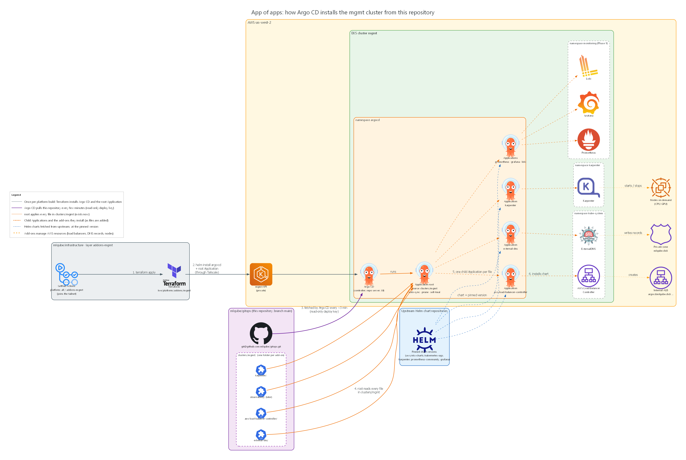

# MlQube GitOps

> Describes the code in [mlqube/gitops](https://github.com/mlqube/gitops). Docs for all repositories live here, in `mlqube/.github` ([index](../README.md)).

The desired state of the [MlQube](https://github.com/mlqube/.github) Kubernetes clusters. **Argo CD** in the management cluster reads this repository and keeps every cluster in sync with it; nobody applies changes to the clusters by hand.

## Layout

| Path | What |
|---|---|
| `clusters/mgmt/` | Argo CD Applications for the management cluster. Terraform installs Argo CD and a root Application pointing here ([ADR-0014](../../adr/0014-ci-access-to-private-clusters.md)); everything else is pulled in from this folder |
| `clusters/wl-nonprod/` | Later, if needed: Applications only the non-prod cluster gets. Shared add-ons reach it through the ApplicationSets in `clusters/mgmt/` |
| `platform/` | Plain manifests that belong to an add-on, one folder each (today: `platform/karpenter/mgmt`, Karpenter's NodePool and EC2NodeClass); later External Secrets, Kyverno, NVIDIA GPU Operator, cert-manager, observability settings |
| `tenants/` | Tenant claims, one per business unit (Phase 2) |

Secrets are never stored here: they come from AWS Secrets Manager through External Secrets. The cluster infrastructure itself lives in [`mlqube/infrastructure`](https://github.com/mlqube/infrastructure).

## How it works: app of apps



| Step | What happens | Who does it |
|---|---|---|
| **1–2** | On every platform build, the `addons-mgmt` layer installs **Argo CD** and one **root Application** in the `mgmt` cluster. The job reaches the private API through Tailscale. | Terraform, from GitHub Actions ([infrastructure](../infrastructure/addons-mgmt.md)) |
| **3** | Argo CD fetches this repository every ~3 minutes with a **read-only deploy key**. The connection goes *out* from the cluster to GitHub; nothing pushes into the cluster. | Argo CD |
| **4** | The `root` Application applies every file under `clusters/mgmt/` (auto-sync, prune, self-heal). | Argo CD |
| **5** | Each file there is itself an Argo CD **Application**, so `root` creates one **child Application per file**: an "app of apps". | Argo CD |
| **6** | Each child Application installs its add-on from the upstream **Helm chart at the pinned version**, with the values in the file. Some add-ons then manage AWS resources: the load balancer controller creates internal ALBs, ExternalDNS writes records into the private zone, Karpenter starts and stops nodes. | Argo CD, then the add-on |

Solid lines in the picture exist after the first platform apply; dashed ones arrive as files are added to `clusters/mgmt/`. The first add-ons (AWS Load Balancer Controller, ExternalDNS, Karpenter) are listed in [`clusters/mgmt/README.md`](clusters-mgmt.md).

### Adding, changing or removing an add-on

Everything is a pull request to this repository; Argo CD picks up the merge within a few minutes.

| To | Do |
|---|---|
| **Add** an add-on | Add a folder `clusters/mgmt/<name>/` with `applicationset.yaml` (an `ApplicationSet` for every cluster; a plain `Application` for one cluster only) and a README |
| **Upgrade** it | Change `targetRevision` (the chart version) in that file |
| **Change its settings** | Change the values in that file |
| **Remove** it | Delete the file: `root` deletes the child Application, and its finalizer uninstalls the add-on |
| **Undo** any of these | Revert the commit |

A child Application looks like this (example; the real versions and values come with each add-on's pull request):

```yaml
apiVersion: argoproj.io/v1alpha1
kind: Application
metadata:
  name: external-dns
  namespace: argocd
  finalizers:
    - resources-finalizer.argocd.argoproj.io # deleting the Application uninstalls the add-on
spec:
  project: default
  source:
    repoURL: https://kubernetes-sigs.github.io/external-dns/
    chart: external-dns
    targetRevision: X.Y.Z # pinned chart version
    helm:
      valuesObject:
        provider:
          name: aws
  destination:
    server: https://kubernetes.default.svc
    namespace: kube-system
  syncPolicy:
    automated:
      prune: true
      selfHeal: true
```

Changes made by hand in the cluster don't last: **self-heal** puts back what this repository says. And because every platform build starts empty, Argo CD reinstalls everything listed here within minutes of each `apply`.

**Later: ApplicationSets.** When the same add-on must run on several clusters (mgmt and `wl-nonprod`), or one app per tenant folder (Phase 2), an `ApplicationSet` (a template plus a generator) creates those Applications instead of copying files. `root` stays the single entry point.

The picture is generated by [`docs/diagrams/platform/app_of_apps.py`](../../diagrams/platform/app_of_apps.py) (Python with `diagrams`, and Graphviz): `python docs/diagrams/platform/app_of_apps.py` from the root of the `.github` repository.

## Checks on every commit

[pre-commit](https://pre-commit.com) validates each commit (YAML syntax and style, formatting, secrets). The same checks run in CI on every push and pull request.

```bash
pip install pre-commit
pre-commit install          # once per clone
pre-commit run --all-files  # run every check by hand
```
