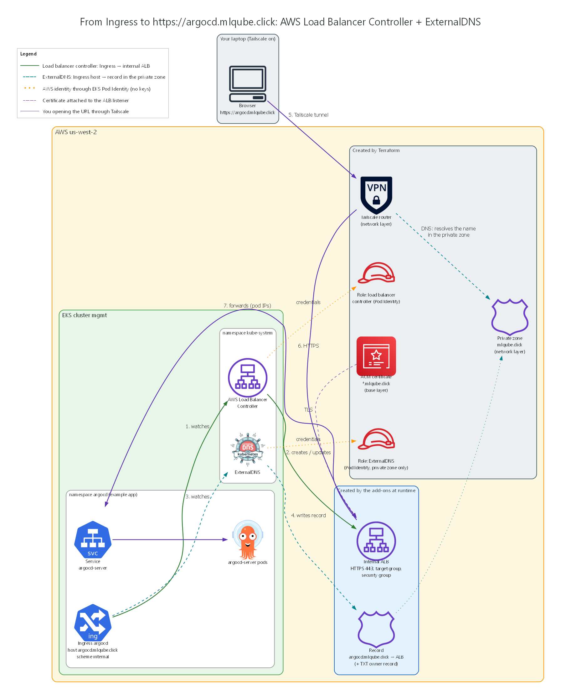

# AWS Load Balancer Controller (every cluster)

> Describes the code in [mlqube/gitops · `clusters/mgmt/aws-load-balancer-controller/`](https://github.com/mlqube/gitops/tree/main/clusters/mgmt/aws-load-balancer-controller). Docs for all repositories live here, in `mlqube/.github` ([index](../README.md)).

Turns Kubernetes **Ingresses** into **internal ALBs** (ADR-0010): no load balancer is ever reachable from the internet. Together with [ExternalDNS](external-dns.md) it gives each web tool a name such as `https://argocd.mlqube.click`, reachable through Tailscale.



## How an Ingress becomes a URL

| Step | What happens |
|---|---|
| 1 | An app (Argo CD in the picture, as the example) has an **Ingress** with `host: argocd.mlqube.click` and the annotation `alb.ingress.kubernetes.io/scheme: internal`. |
| 2 | The controller sees it and creates an **internal ALB** in the private subnets (tagged `kubernetes.io/role/internal-elb`), an HTTPS 443 listener with the ACM certificate `*.mlqube.click`, a **target group** pointing straight at the pod IPs (VPC CNI), and a security group. |
| 3–4 | [ExternalDNS](external-dns.md) sees the same Ingress and writes `argocd.mlqube.click → ALB` into the **private** zone. |
| 5–7 | Your browser resolves the name through Tailscale split DNS, connects through the tunnel and the router to the ALB, which forwards to the pods. |

Change or delete the Ingress and the controller updates or deletes the ALB; ExternalDNS removes the record.

## What exists, and who creates it

| Created by | What |
|---|---|
| **Terraform** (`addons-mgmt` layer) | IAM role + **Pod Identity association** `kube-system/aws-load-balancer-controller`, with the controller's standard policy ([`app_pod_identity.tf`](https://github.com/mlqube/infrastructure/blob/main/live/platform/addons/mgmt/app_pod_identity.tf)) |
| **Terraform** (other layers) | The certificate (`base`), the subnets with their load balancer tags and the private zone (`network`) |
| **Argo CD from this folder** | The controller (Helm chart 3.6.2, `kube-system`, 1 replica) and its webhooks and CRDs (`TargetGroupBinding`, `IngressClassParams`) |
| **The controller, at runtime** | ALBs, listeners, target groups, security groups, for each Ingress |

## Settings ([`applicationset.yaml`](https://github.com/mlqube/gitops/blob/main/clusters/mgmt/aws-load-balancer-controller/applicationset.yaml))

One Application per cluster (`mgmt-aws-load-balancer-controller`, `wl-nonprod-aws-load-balancer-controller`); values in `{{…}}` come from each cluster's secret.

| Value | Why |
|---|---|
| `clusterName: {{.name}}` | Tags and names its AWS resources with the cluster (`mgmt`, `wl-nonprod`) |
| `region: us-west-2`, `vpcTags: {Name: <mlqube/vpc-name>}` (`mlqube-mgmt`, `mlqube-nonprod`) | Nodes allow only one metadata hop (IMDSv2), so the controller can't look up its region and VPC itself |
| `replicaCount: 1` | Reference build; two in production |
| `serviceAccount.name: aws-load-balancer-controller` | Must match the Pod Identity association in Terraform |

## Status

The first Ingress is **Argo CD's own**, `https://argocd.mlqube.click`, created by the Argo CD Helm chart from Terraform ([addons-mgmt README](../infrastructure/addons-mgmt.md#opening-argo-cd)). It uses `group.name: mlqube-mgmt`, so later portals (Grafana, Backstage, MLflow) join the **same ALB** by setting the same group name. One ALB costs about $0.0225/hour plus usage while it exists; on `platform` destroy, the `addons-mgmt` job deletes Ingresses first and waits until the controller has removed the ALBs.

```bash
kubectl --context mgmt -n kube-system logs deploy/aws-load-balancer-controller --tail=50
```

The picture is generated by [`docs/diagrams/platform/addon_diagrams.py`](../../diagrams/platform/addon_diagrams.py).
