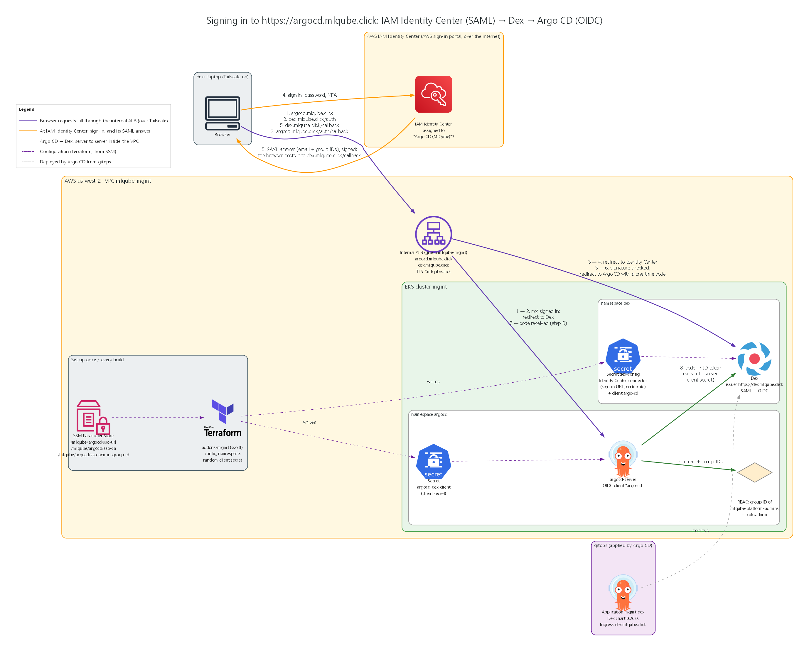

# Dex (mgmt): the identity broker

> Describes the code in [mlqube/gitops · `clusters/mgmt/dex/`](https://github.com/mlqube/gitops/tree/main/clusters/mgmt/dex) and its configuration in [mlqube/infrastructure · `sso.tf`](https://github.com/mlqube/infrastructure/blob/main/live/platform/addons/mgmt/sso.tf). Docs for all repositories live here, in `mlqube/.github` ([index](../README.md)).

**IAM Identity Center** does the single sign-on: who you are, password and MFA, your groups, and which applications you may use. For custom applications it speaks only **SAML**. Most of MlQube's tools speak **OIDC**. **Dex** translates: it receives Identity Center's SAML answer and gives each tool an OIDC token with your email and **group IDs**. It stores no users and no passwords ([ADR-0015](../../adr/0015-iam-identity-center-identity-hub.md)).



| Step | What happens |
|---|---|
| **1** | You open `https://argocd.mlqube.click`. Like every request in this flow, it goes over Tailscale to the **internal ALB**, which serves both `argocd.` and `dex.mlqube.click`. |
| **2** | Argo CD sees you aren't signed in and **redirects** your browser to Dex (an OIDC sign-in request for the client `argo-cd`). |
| **3** | Your browser opens `https://dex.mlqube.click/auth`. |
| **4** | Dex **redirects** you to IAM Identity Center (a SAML request). You sign in there with your usual AWS sign-in: password and MFA. Identity Center checks that you're assigned to the application `Argo CD (MlQube)`. This is the only step outside the VPC. |
| **5** | Identity Center hands your browser a **signed SAML answer** (your email and group IDs), which the browser posts to `https://dex.mlqube.click/callback`. |
| **6** | Dex checks the signature against Identity Center's certificate (from its config) and **redirects** you back to Argo CD with a one-time code. |
| **7** | Your browser opens `https://argocd.mlqube.click/auth/callback` with that code. |
| **8** | Argo CD trades the code for an **ID token** directly with Dex, **server to server** inside the VPC, proving itself with its client secret. The token never passes through your browser. |
| **9** | Argo CD reads your email and group IDs from the token. RBAC maps the group ID of `mlqube-platform-admins` to `role:admin`; anyone else gets no access. You're in. |

The next time you sign in to another tool behind Dex, step 4 is just a quick redirect: Identity Center still has your session.

Dex runs **once, in mgmt**, as its own add-on, and every tool is a client of it: **Argo CD** today, and later **Argo Workflows**, **Backstage**, **Grafana** and **MLflow**. Before, it was the copy bundled inside Argo CD; separating it means the other tools' sign-in doesn't depend on Argo CD's installation or settings.

`kubectl` doesn't use Dex: it goes through your Identity Center role and an EKS access entry.

## Who owns what

| Part | Where | Why there |
|---|---|---|
| **Dex itself** (chart version, replicas, Ingress `dex.mlqube.click`) | gitops, [`clusters/mgmt/dex/application.yaml`](https://github.com/mlqube/gitops/blob/main/clusters/mgmt/dex/application.yaml): Dex chart **0.26.0** (Dex v2.46.0), namespace `dex`, mgmt only | Deployed and upgraded by Argo CD like every add-on |
| **Dex's configuration**, the Secret `dex/dex-config` (the Identity Center connector, one client per tool) | Terraform, [`sso.tf`](https://github.com/mlqube/infrastructure/blob/main/live/platform/addons/mgmt/sso.tf) (`addons-mgmt` layer), with the `dex` namespace | Its inputs are there: Identity Center's sign-in URL and certificate (SSM Parameter Store) and each tool's client secret |
| **Each tool's client secret** | Terraform: random, new on every build, written to Dex's config and to the tool's own namespace (Argo CD: Secret `argocd/argocd-dex-client`) | Generated with the config, so both sides always match; never stored anywhere permanent |
| **The Identity Center application** `Argo CD (MlQube)` | You, in the console ([setup step 10b](../setup.md#10b-argo-cd-single-sign-on-iam-identity-center)). ACS URL and audience: **`https://dex.mlqube.click/callback`** | CI may not touch Identity Center (bootstrap guardrail) |

## Settings

| Setting | Value | Why |
|---|---|---|
| Issuer | `https://dex.mlqube.click` | The address every tool and every browser uses; through the shared internal ALB (IngressGroup `mlqube-mgmt`), ACM certificate found by host name |
| Storage | Kubernetes (Dex creates its own CRDs on first start) | Signing keys and sign-in state survive a Dex restart; gone with each destroy |
| Connector | SAML, `aws-identity-center`: email from `email`, groups from `groups` (`${user:groups}`, group **IDs**) | Identity Center's attribute mappings ([setup step 10b](../setup.md#10b-argo-cd-single-sign-on-iam-identity-center)) |
| Clients | `argo-cd` (redirects to `https://argocd.mlqube.click/auth/callback` and to `localhost:8085` for `argocd login --sso`) | One entry per tool |
| Approval screen | Off | Every client is ours; no "allow this application?" page |
| Replicas | 1 | Reference build; two in production (they share state in Kubernetes) |

Dex reads its configuration at start. After changing it on a running platform (re-applying `addons-mgmt`), restart it: `kubectl --context mgmt -n dex rollout restart deployment/dex`. A fresh build needs nothing: the Secret exists before Argo CD deploys Dex.

## Adding a tool (e.g. Argo Workflows)

1. In `sso.tf`: a `random_password` for the tool, a `staticClients` entry (id, name, secret, redirect URIs), and a Secret with the client secret in the tool's namespace.
2. In the tool's gitops values: OIDC issuer `https://dex.mlqube.click`, its client ID, the Secret, scopes `openid profile email groups`, and its group-ID → role mapping.
3. In Identity Center: nothing. It's the same SAML application; whoever is assigned to it can reach every tool, and each tool's RBAC decides what they may do there.

## If Dex is down

Nobody can sign in to the tools; running workloads are not affected. The ways in:

- **`kubectl`** through Identity Center (doesn't use Dex): `kubectl --context mgmt -n dex get pods`, `kubectl --context mgmt -n dex logs deployment/dex`.
- **Argo CD's local admin**, as break-glass: set `argocd_admin_enabled = true`, apply `addons-mgmt`, then set it back ([addons-mgmt](../infrastructure/addons-mgmt.md#break-glass-the-local-admin)).

## Checking it (once the platform runs)

```bash
kubectl --context mgmt -n dex get pods,ingress
curl -s https://dex.mlqube.click/.well-known/openid-configuration   # Dex's OIDC metadata (Tailscale on)
```

Then open `https://argocd.mlqube.click` → **Log in via AWS Identity Center**.

The picture is generated by [`docs/diagrams/platform/sso_diagram.py`](../../diagrams/platform/sso_diagram.py): `python docs/diagrams/platform/sso_diagram.py` from the root of the `.github` repository.
