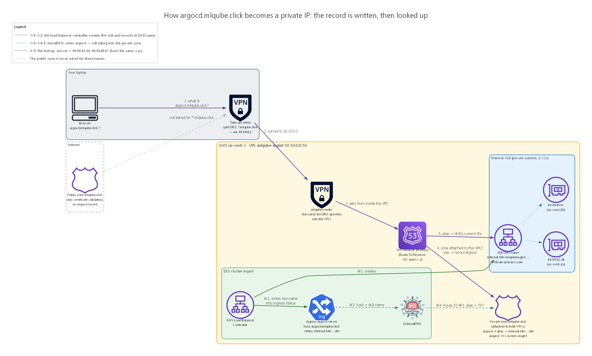

# ExternalDNS (every cluster)

> Describes the code in [mlqube/gitops · `clusters/mgmt/external-dns/`](https://github.com/mlqube/gitops/tree/main/clusters/mgmt/external-dns). Docs for all repositories live here, in `mlqube/.github` ([index](../README.md)).

Keeps DNS records in the **private** hosted zone `mlqube.click` in sync with the cluster: for every Ingress (or `LoadBalancer` Service) with a host name, it writes `name → load balancer`. That is how `argocd.mlqube.click` will point at Argo CD's internal ALB without anyone editing DNS by hand.

The flow, together with the [AWS Load Balancer Controller](aws-load-balancer-controller.md), is drawn in [`ingress-flow.png`](../images/ingress-flow.png) (steps 3–4).

## How it works

| Step | What happens |
|---|---|
| 1 | It watches Ingresses and Services in the cluster. |
| 2 | For a host under `mlqube.click` whose load balancer address is known, it creates an **alias record** in the private zone, plus a **TXT record** that marks the name as owned by this cluster (`txtOwnerId` = the cluster's name). |
| 3 | When the Ingress changes or goes away, it updates or deletes the record (`policy: sync`). It never touches records without its TXT ownership marker. |

Only machines inside the VPCs, and your laptop through Tailscale split DNS, can resolve these names. The public zone `mlqube.click` is never changed (`--aws-zone-type=private`).

## How a name becomes a private IP



**Writing the record (once, and on every change):**

| Step | What happens |
|---|---|
| W1 | The AWS Load Balancer Controller creates the internal ALB. AWS gives every ALB a **DNS name**, e.g. `internal-k8s-mlqubemgmt-1a2b3c.us-west-2.elb.amazonaws.com`, standing for its private IPs (one per subnet; AWS may change them). |
| W2 | The controller writes that DNS name into the Ingress status (`status.loadBalancer.ingress[0].hostname`). |
| W3 | ExternalDNS reads the Ingress: its host (`argocd.mlqube.click`) and the ALB name. |
| W4 | It calls the Route 53 API and writes into the **private** zone: `argocd.mlqube.click A (alias) → <ALB name>`, plus a TXT record marking it as owned by `mgmt`. An **alias** points at the ALB's *name*, not a fixed IP, so it stays right when AWS changes the IPs. |

**Looking it up (every time a browser asks):**

| Step | What happens |
|---|---|
| 1 | The browser asks for `argocd.mlqube.click`. |
| 2 | The Tailscale client's **split DNS** rule: names ending in `mlqube.click` go to `10.10.0.2`, the mgmt VPC's resolver, through the tunnel. |
| 3 | The router forwards the question into the VPC, so it reaches the resolver **from inside the VPC**. |
| 4 | The resolver (Route 53 Resolver, always at the VPC range + 2) checks: is a private zone for this name **attached to this VPC**? Yes → it reads the `argocd` record. |
| 5 | The record is an alias, so the resolver resolves the ALB's name to its **current private IPs** and answers, e.g. `10.10.12.34, 10.10.45.67`. The browser then connects to one of them (through the same tunnel; see the [ingress flow](aws-load-balancer-controller.md)). |

The **public** zone of the same name is never asked for these names, and doesn't contain them: from the internet, `argocd.mlqube.click` doesn't exist. Other names (e.g. `github.com`) keep using the laptop's normal DNS.

To see it once the platform runs: `nslookup argocd.mlqube.click` (two `10.10.x.x` addresses), or **Route 53 → Hosted zones → `mlqube.click` (Private)** for the records.

## What exists, and who creates it

| Created by | What |
|---|---|
| **Terraform** (`addons-mgmt` layer) | IAM role + **Pod Identity association** `kube-system/external-dns`; its policy allows record changes **in the private zone only** ([`app_pod_identity.tf`](https://github.com/mlqube/infrastructure/blob/main/live/platform/addons/mgmt/app_pod_identity.tf)) |
| **Terraform** (`network` layer) | The private zone `mlqube.click`, attached to both VPCs |
| **Argo CD from this folder** | ExternalDNS (Helm chart 1.23.0 = ExternalDNS 0.23.0, `kube-system`) |
| **ExternalDNS, at runtime** | Alias and TXT records in the private zone |

## Settings ([`applicationset.yaml`](https://github.com/mlqube/gitops/blob/main/clusters/mgmt/external-dns/applicationset.yaml))

One Application per cluster (`mgmt-external-dns`, `wl-nonprod-external-dns`); values in `{{…}}` come from each cluster's secret. Both write into the same private zone, each only its own names: mgmt `*.mlqube.click`, wl-nonprod `*.nonprod.mlqube.click`.

| Value | Why |
|---|---|
| `provider.name: aws`, `AWS_DEFAULT_REGION=us-west-2` | Route 53 in this region |
| `domainFilters: [mlqube.click]`, `--aws-zone-type=private` | Only the private zone of this domain |
| `sources: [ingress, service]` | Where host names come from |
| `policy: sync`, `registry: txt`, `txtOwnerId: {{.name}}` | Create, update **and delete** its own records; leave everything else alone |
| `serviceAccount.name: external-dns` | Must match the Pod Identity association in Terraform |

## Status

The first record is **`argocd.mlqube.click`**, from Argo CD's Ingress (created by Terraform's `addons-mgmt` layer). Records left behind at destroy don't matter: the network layer deletes the private zone with its content (`force_destroy`).

```bash
kubectl --context mgmt -n kube-system logs deploy/external-dns --tail=50
```
