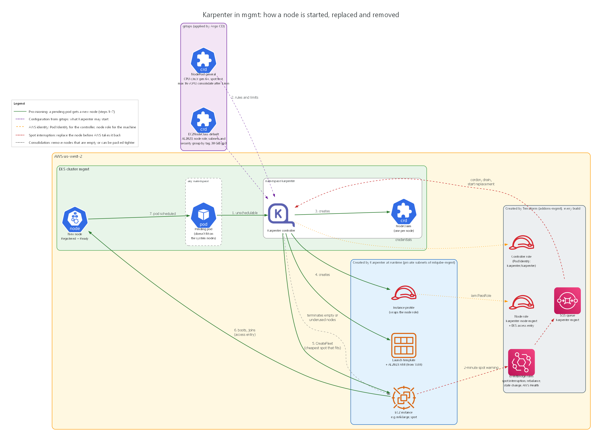

# Karpenter (every cluster)

> Describes the code in [mlqube/gitops · `clusters/mgmt/karpenter/`](https://github.com/mlqube/gitops/tree/main/clusters/mgmt/karpenter). Docs for all repositories live here, in `mlqube/.github` ([index](../README.md)).

Karpenter starts EC2 nodes when pods don't fit on the existing nodes, picks the cheapest instance that fits (spot first), replaces spot nodes before AWS takes them back, and removes nodes that are empty or underused. The cluster's own **system node group** (2 spot nodes, created by Terraform) runs the platform components; Karpenter adds nodes **on top** of it, only when needed.

Each cluster Argo CD manages runs its **own** Karpenter (one Application per cluster from the ApplicationSet). The picture shows mgmt; `wl-nonprod` works the same with its own names: controller role for `karpenter/karpenter` in wl-nonprod, node role `karpenter-node-wl-nonprod`, queue `karpenter-wl-nonprod`, NodePools from [`platform/karpenter/wl-nonprod`](https://github.com/mlqube/gitops/tree/main/platform/karpenter/wl-nonprod).



## How a node is started (green, steps 1–7)

| Step | What happens |
|---|---|
| 1 | A pod can't be scheduled: no node has enough CPU or memory left. |
| 2 | Karpenter reads what it may start: the `NodePool` (`general`) and the `EC2NodeClass` (`default`) from [`platform/karpenter/mgmt`](https://github.com/mlqube/gitops/tree/main/platform/karpenter/mgmt). |
| 3 | It creates a **NodeClaim**: Kubernetes' record of "one node requested, with these requirements". |
| 4 | It creates a **launch template** (Amazon Linux 2023 AMI, looked up in SSM) and an **instance profile** for the node role. |
| 5 | It calls EC2 **CreateFleet** for the cheapest spot instance that fits (on-demand if no spot is available), in a private subnet of `mlqube-mgmt`. |
| 6 | The instance boots and joins the cluster: the node role's **EKS access entry** lets it in. |
| 7 | The pending pod is scheduled on the new node. Usually under a minute from step 1. |

**Spot interruption (red):** AWS gives 2 minutes' notice before taking a spot instance back. EventBridge forwards the warning to the SQS queue `karpenter-mgmt`; Karpenter reads it, **cordons and drains** the node, and starts a replacement right away.

**Consolidation (grey):** a node that has been empty, or whose pods fit elsewhere, for 1 minute is drained and terminated. Every node is also replaced after 7 days (`expireAfter`), so it picks up newer AMIs.

## What exists, and who creates it

| Created by | What | Where |
|---|---|---|
| **Terraform** (`addons-mgmt` layer, every platform build) | Controller IAM role + **Pod Identity association** `karpenter/karpenter`; node IAM role `karpenter-node-<cluster>` with its **EKS access entry**; SQS queue `karpenter-<cluster>`; EventBridge rules (spot interruption, rebalance, instance state change, AWS Health) | [`app_pod_identity.tf`](https://github.com/mlqube/infrastructure/blob/main/live/platform/addons/mgmt/app_pod_identity.tf) |
| **Argo CD from this folder** | The Karpenter controller (Helm chart 1.14.3, namespace `karpenter`) and its CRDs; the `NodePool` and `EC2NodeClass` | [`applicationset.yaml`](https://github.com/mlqube/gitops/blob/main/clusters/mgmt/karpenter/applicationset.yaml), [`nodepools-applicationset.yaml`](https://github.com/mlqube/gitops/blob/main/clusters/mgmt/karpenter/nodepools-applicationset.yaml), [`oci-repository.yaml`](https://github.com/mlqube/gitops/blob/main/clusters/mgmt/karpenter/oci-repository.yaml) |
| **Karpenter itself, at runtime** | `NodeClaim` objects, launch templates, instance profiles, **EC2 instances** (and their disks) | AWS account, tagged with the cluster name |

## The two AWS identities

| Identity | Used by | Allows |
|---|---|---|
| **Controller role** (EKS Pod Identity) | The Karpenter pod | Launch and terminate EC2 instances and launch templates **tagged for this cluster**; read instance types, prices, subnets and AMIs; read the interruption queue; `iam:PassRole` on the node role only |
| **Node role** `karpenter-node-<cluster>` (instance profile) | Each node Karpenter starts | Join EKS (`AmazonEKSWorkerNodePolicy`), pull images (`AmazonEC2ContainerRegistryPullOnly`), pod networking (`AmazonEKS_CNI_Policy`), same as the system nodes |

## Files

| File | What |
|---|---|
| [`applicationset.yaml`](https://github.com/mlqube/gitops/blob/main/clusters/mgmt/karpenter/applicationset.yaml) | ApplicationSet: one Karpenter per cluster (`<cluster>-karpenter`), chart 1.14.3 from `public.ecr.aws/karpenter`, `clusterName: <cluster>`, `interruptionQueue: karpenter-<cluster>`, 1 replica |
| [`nodepools-applicationset.yaml`](https://github.com/mlqube/gitops/blob/main/clusters/mgmt/karpenter/nodepools-applicationset.yaml) | ApplicationSet: `<cluster>-karpenter-nodepools` from [`platform/karpenter/<cluster>`](https://github.com/mlqube/gitops/tree/main/platform/karpenter); retries until Karpenter's CRDs exist |
| [`../../../platform/karpenter/wl-nonprod/`](https://github.com/mlqube/gitops/tree/main/platform/karpenter/wl-nonprod) | wl-nonprod's `EC2NodeClass default` (node role `karpenter-node-wl-nonprod`, subnets tagged `mlqube-nonprod`, security group tagged `wl-nonprod`) and `NodePool general` (CPU, spot first, **max 32 vCPUs**). GPU NodePool once the GPU instance quota is confirmed |
| [`oci-repository.yaml`](https://github.com/mlqube/gitops/blob/main/clusters/mgmt/karpenter/oci-repository.yaml) | Tells Argo CD the chart is in a public OCI registry (no credentials) |
| [`../../../platform/karpenter/mgmt/nodepool.yaml`](https://github.com/mlqube/gitops/blob/main/platform/karpenter/mgmt/nodepool.yaml) | `NodePool general`: c/m/r families, generation 6+, amd64, spot then on-demand, **max 16 vCPUs**, consolidate after 1 minute, replace after 7 days |
| [`../../../platform/karpenter/mgmt/ec2nodeclass.yaml`](https://github.com/mlqube/gitops/blob/main/platform/karpenter/mgmt/ec2nodeclass.yaml) | `EC2NodeClass default`: AL2023, node role, subnets tagged `karpenter.sh/discovery: mlqube-mgmt`, security group tagged `karpenter.sh/discovery: mgmt`, IMDSv2, 30 GiB encrypted gp3 |

## Cost and safety

- Nothing extra while nothing is pending: Karpenter only starts a node for pods that don't fit on the system nodes.
- The `NodePool` limit (16 vCPUs) caps how much it can ever start.
- On `platform` destroy, the `addons-mgmt` job deletes the NodePools first and waits until Karpenter has terminated its nodes, so no instance is left behind to block the network destroy.
- GPU NodePools belong to the workload cluster (`wl-nonprod`), not mgmt.

## Checking it

```bash
kubectl --context mgmt get nodepools,ec2nodeclasses,nodeclaims
```

```bash
kubectl --context mgmt -n karpenter logs deploy/karpenter --tail=50
```

The picture is generated by [`docs/diagrams/platform/addon_diagrams.py`](../../diagrams/platform/addon_diagrams.py).
