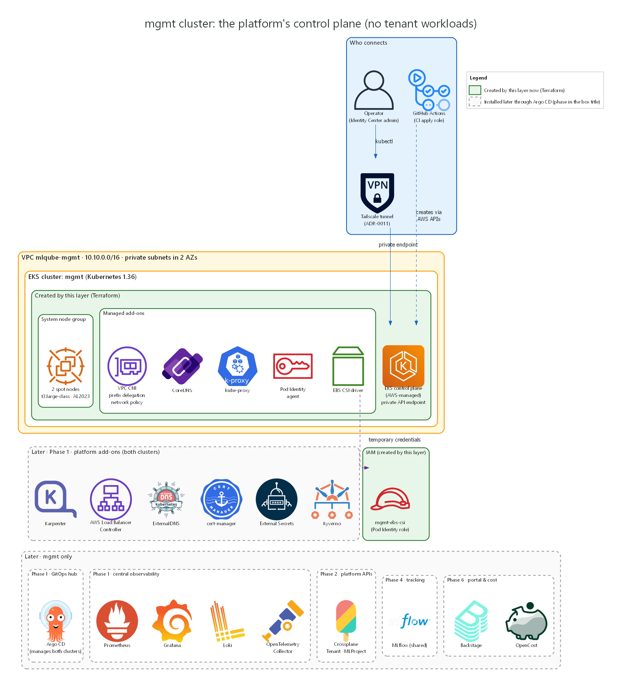

# mgmt layer: management EKS cluster

> Describes the code in [mlqube/infrastructure · `live/platform/eks/mgmt/`](https://github.com/mlqube/infrastructure/tree/main/live/platform/eks/mgmt). Docs for all repositories live here, in `mlqube/.github` ([index](../README.md)).

> Terraform root for the `mgmt` cluster: [`main.tf`](https://github.com/mlqube/infrastructure/blob/main/live/platform/eks/mgmt/main.tf), [`variables.tf`](https://github.com/mlqube/infrastructure/blob/main/live/platform/eks/mgmt/variables.tf), [`outputs.tf`](https://github.com/mlqube/infrastructure/blob/main/live/platform/eks/mgmt/outputs.tf). Cluster settings are shared with `wl-nonprod` through the [`eks-cluster` module](module-eks-cluster.md). Back to the [repository README](README.md).

The platform's control plane ([ADR-0003](../../adr/0003-cluster-topology.md)): Argo CD, Crossplane, Backstage, MLflow and central observability. **Tenant workloads never run here.**

| | |
|---|---|
| Cluster | `mgmt`, Kubernetes 1.36 |
| VPC | `mlqube-mgmt` (10.10.0.0/16), private subnets ([network layer](network.md)) |
| State | `s3://mlqube-tfstate-<account-id>-us-west-2/platform/eks/mgmt/terraform.tfstate` |
| Depends on | `network` (reads its state) |
| Independent of | `wl-nonprod`: either cluster can exist without the other |
| Cost while it exists | about $0.16/hour |

## Components



**Green, solid boxes: created by this layer now** (Terraform, when you apply `mgmt`):

- The **EKS control plane** (managed by AWS) with a private API endpoint
- A **system node group** of 2 spot nodes
- Managed add-ons: **VPC CNI** (pod networking and network policy), **CoreDNS**, **kube-proxy**, the **Pod Identity agent** and the **EBS CSI driver**
- The IAM role `mgmt-ebs-csi`, which the EBS CSI driver uses through Pod Identity

**Grey, dashed boxes: installed later through Argo CD**, in the roadmap phase shown in each box:

| Phase | Components | Purpose |
|---|---|---|
| 1 | Karpenter, AWS Load Balancer Controller, ExternalDNS, cert-manager, External Secrets, Kyverno | Platform add-ons, in both clusters |
| 1 | **Argo CD** | GitOps hub that installs and manages everything in both clusters |
| 1 | Prometheus, Grafana, Loki, OpenTelemetry Collector | Central observability for both clusters |
| 2 | Crossplane (`Tenant`, `MLProject` APIs) | Self-service platform APIs |
| 4 | MLflow | Shared tracking and model registry |
| 6 | Backstage, OpenCost | Developer portal; cost per business unit |

So right after `apply`, expect an empty but working cluster: `kubectl get nodes` shows 2 nodes, and `kube-system` holds the add-ons. Nothing from the dashed boxes is there until Argo CD is set up.

The picture is generated by [`docs/diagrams/platform/cluster_diagrams.py`](../../diagrams/platform/cluster_diagrams.py); to update it, edit that script and run `python docs/diagrams/platform/cluster_diagrams.py` from the root of the `.github` repository.

## Run it

1. The `network` layer must be applied first.
2. **Actions → platform → Run workflow:** layer `mgmt`, action `plan` to review, then `apply` (about 10–15 minutes). Or layer `all` to create the network and both clusters in one run (the clusters in parallel).
3. Add the cluster to your kubeconfig (the `kubeconfig_command` output prints this):

   ```bash
   aws eks update-kubeconfig --region us-west-2 --name mgmt --profile mlqube
   ```

   This needs network access to the API endpoint: through the Tailscale router (private endpoint), or from an IP in `EKS_PUBLIC_ACCESS_CIDRS`.
4. When done: layer `mgmt`, action `destroy`, type `mgmt` to confirm. Destroy both clusters before the network.

On pull requests, `terraform-plan` validates this layer, and plans it once the network layer exists.
