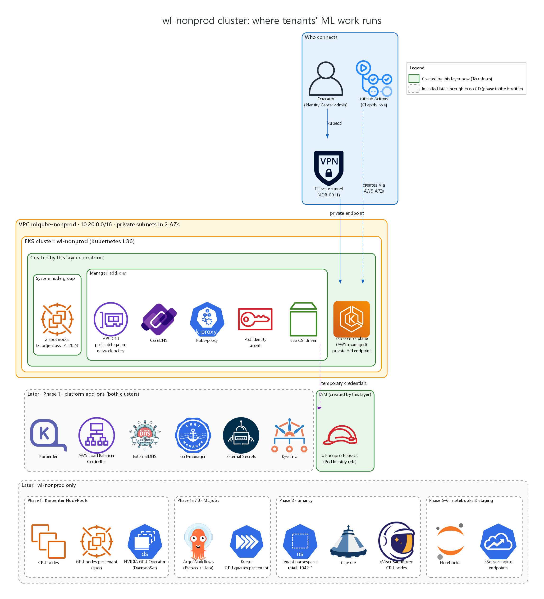

# wl-nonprod layer: non-prod workload EKS cluster

> Describes the code in [mlqube/infrastructure · `live/platform/eks/wl-nonprod/`](https://github.com/mlqube/infrastructure/tree/main/live/platform/eks/wl-nonprod). Docs for all repositories live here, in `mlqube/.github` ([index](../README.md)).

> Terraform root for the `wl-nonprod` cluster: [`main.tf`](https://github.com/mlqube/infrastructure/blob/main/live/platform/eks/wl-nonprod/main.tf), [`variables.tf`](https://github.com/mlqube/infrastructure/blob/main/live/platform/eks/wl-nonprod/variables.tf), [`outputs.tf`](https://github.com/mlqube/infrastructure/blob/main/live/platform/eks/wl-nonprod/outputs.tf). Cluster settings are shared with `mgmt` through the [`eks-cluster` module](module-eks-cluster.md). Back to the [repository README](README.md).

Where tenants' work runs ([ADR-0003](../../adr/0003-cluster-topology.md)): tenant namespaces, Argo Workflows training jobs, notebooks and staging model endpoints. Karpenter adds CPU, gVisor and GPU nodes later; the cluster starts with a small system node group.

| | |
|---|---|
| Cluster | `wl-nonprod`, Kubernetes 1.36 |
| VPC | `mlqube-nonprod` (10.20.0.0/16), private subnets ([network layer](network.md)) |
| State | `s3://mlqube-tfstate-<account-id>-us-west-2/platform/eks/wl-nonprod/terraform.tfstate` |
| Depends on | `network` (reads its state) |
| Independent of | `mgmt`: either cluster can exist without the other (e.g. only `wl-nonprod` for a quick GPU test) |
| Cost while it exists | about $0.16/hour, plus any GPU nodes while they run |

## Components



**Green, solid boxes: created by this layer now** (Terraform, when you apply `wl-nonprod`):

- The **EKS control plane** (managed by AWS) with a private API endpoint
- A **system node group** of 2 spot nodes
- Managed add-ons: **VPC CNI** (pod networking and network policy), **CoreDNS**, **kube-proxy**, the **Pod Identity agent** and the **EBS CSI driver**
- The IAM role `wl-nonprod-ebs-csi`, which the EBS CSI driver uses through Pod Identity

**Grey, dashed boxes: installed later through Argo CD** (from the `mgmt` cluster), in the roadmap phase shown in each box:

| Phase | Components | Purpose |
|---|---|---|
| 1 | Karpenter, AWS Load Balancer Controller, ExternalDNS, cert-manager, External Secrets, Kyverno | Platform add-ons, in both clusters |
| 1 | Karpenter NodePools: CPU nodes, GPU nodes per tenant (spot); NVIDIA GPU Operator | Workload capacity that appears when jobs need it and scales back to zero |
| 1a / 3 | Argo Workflows (Python + Hera), Kueue | ML jobs and pipelines; GPU queues and quotas per tenant |
| 2 | Tenant namespaces (e.g. `retail-1042-*`), Capsule, gVisor-sandboxed CPU nodes | Tenant isolation |
| 5–6 | Notebooks, KServe staging endpoints | Development environments and staging models |

So right after `apply`, expect an empty but working cluster: `kubectl get nodes` shows 2 nodes, and `kube-system` holds the add-ons. Tenants, jobs and GPU nodes arrive with the later phases.

The picture is generated by [`docs/diagrams/platform/cluster_diagrams.py`](../../diagrams/platform/cluster_diagrams.py); to update it, edit that script and run `python docs/diagrams/platform/cluster_diagrams.py` from the root of the `.github` repository.

## Run it

1. The `network` layer must be applied first.
2. **Actions → platform → Run workflow:** layer `wl-nonprod`, action `plan` to review, then `apply` (about 10–15 minutes). Or layer `all` to create the network and both clusters in one run (the clusters in parallel).
3. Add the cluster to your kubeconfig (the `kubeconfig_command` output prints this):

   ```bash
   aws eks update-kubeconfig --region us-west-2 --name wl-nonprod --profile mlqube
   ```

   This needs network access to the API endpoint: through the Tailscale router (private endpoint), or from an IP in `EKS_PUBLIC_ACCESS_CIDRS`.
4. When done: layer `wl-nonprod`, action `destroy`, type `wl-nonprod` to confirm. Destroy both clusters before the network.

On pull requests, `terraform-plan` validates this layer, and plans it once the network layer exists.
