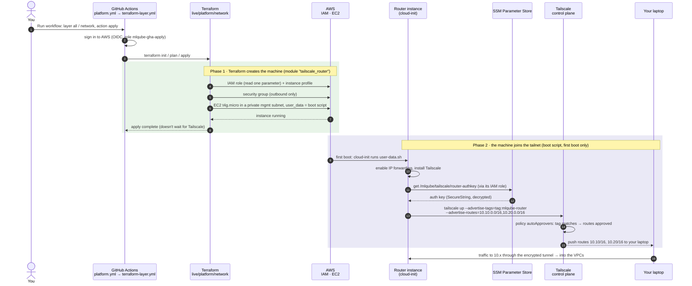
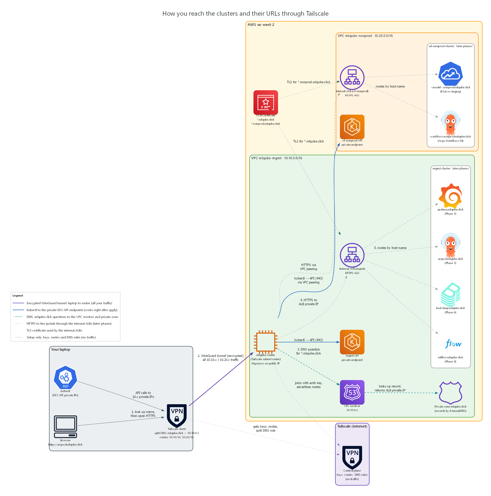

# Module: tailscale-router

> Describes the code in [mlqube/infrastructure · `modules/tailscale-router/`](https://github.com/mlqube/infrastructure/tree/main/modules/tailscale-router). Docs for all repositories live here, in `mlqube/.github` ([index](../README.md)).

The Tailscale **subnet router** ([ADR-0011](../../adr/0011-private-access-reference-build.md)): the operator's laptop reaches the private VPCs through it, for `kubectl` against the private EKS API endpoints and, later, the portals behind the internal ALBs. Used by the [network layer](network.md), so it is created and destroyed with the network.

| Part | Setting |
|---|---|
| Instance | `t4g.micro` (ARM, 1 GB), latest Amazon Linux 2023, 8 GB encrypted gp3 disk, IMDSv2 only |
| Network | Private subnet of the mgmt VPC; **no public IP, no inbound rules**; outbound only (Tailscale, packages, forwarded traffic) through the NAT gateway; source/destination check off (it forwards traffic) |
| Joins the tailnet | At boot: reads the auth key from SSM Parameter Store, runs `tailscale up --advertise-tags=tag:mlqube-router --advertise-routes=10.10.0.0/16,10.20.0.0/16` |
| Route approval | Automatic: the tailnet policy's `autoApprovers` approve those routes for `tag:mlqube-router` |
| IAM role | `ssm:GetParameter` on the auth key parameter only, plus `AmazonSSMManagedInstanceCore` for debugging through SSM Session Manager (no SSH keys, no open ports) |
| Cost | About $0.008/hour (~$0.20 per day it runs) |

## How the router gets created

Nobody calls the router on its own: it is part of the **network layer**, so every `network` (or `all`) apply creates it and every destroy removes it. Two things happen one after the other: **Terraform creates the machine**, then **the machine joins the tailnet** by itself when it boots.



The same chain as files:

| Step | File | What it does |
|---|---|---|
| 1–2 | [`.github/workflows/platform.yml`](https://github.com/mlqube/infrastructure/blob/main/.github/workflows/platform.yml) | Your "Run workflow" click; picks the network layer (`all` or `network`) |
| 3 | [`.github/workflows/terraform-layer.yml`](https://github.com/mlqube/infrastructure/blob/main/.github/workflows/terraform-layer.yml) | Signs in to AWS and runs Terraform in `live/platform/network` |
| 4–8 | [`live/platform/network/main.tf`](https://github.com/mlqube/infrastructure/blob/main/live/platform/network/main.tf) → [`main.tf`](https://github.com/mlqube/infrastructure/blob/main/modules/tailscale-router/main.tf) (this module) | `module "tailscale_router"` (`count = var.enable_tailscale_router ? 1 : 0`) creates the IAM role, security group and instance |
| 9–14 | [`user-data.sh.tftpl`](https://github.com/mlqube/infrastructure/blob/main/modules/tailscale-router/user-data.sh.tftpl) | The boot script cloud-init runs: installs Tailscale, reads the key, runs `tailscale up` |
| 14–15 | Tailscale policy (admin console) | `autoApprovers` approve the routes; the control plane pushes them to your devices |

That is why `mlqube-router` appears in the Tailscale admin console a minute or two **after** the network job turns green.

**Destroy** works the other way round: `all` / `network` → `destroy` makes Terraform terminate the instance with the rest of the network. The auth key is **ephemeral**, so Tailscale removes `mlqube-router` from the machine list on its own shortly after it goes offline; the next apply joins a fresh one with the same key.

## How you connect: URLs and paths



Everything goes through one encrypted **WireGuard tunnel** from your laptop to the router (purple). Nothing in AWS is reachable from the internet: the router has no public IP and no inbound rules; it connected out to Tailscale, and your laptop found it through the Tailscale control plane, which only exchanges keys, routes and DNS rules (light purple, dotted).

### What you can reach, and when

| What | Address | Path | Available |
|---|---|---|---|
| **mgmt cluster API** (`kubectl`) | `https://<id>.gr7.us-west-2.eks.amazonaws.com` (private IPs in 10.10.x.x) | tunnel → router → mgmt API private endpoint | Right after `mgmt` (or `all`) apply |
| **wl-nonprod cluster API** (`kubectl`) | `https://<id>.gr7.us-west-2.eks.amazonaws.com` (private IPs in 10.20.x.x) | tunnel → router → VPC peering → wl-nonprod API | Right after `wl-nonprod` (or `all`) apply |
| Argo CD | `https://argocd.mlqube.click` | tunnel → router → mgmt internal ALB | Phase 1 (Argo CD + add-ons) |
| Grafana | `https://grafana.mlqube.click` | same | Phase 1 (observability) |
| MLflow | `https://mlflow.mlqube.click` | same | Phase 4 |
| Backstage | `https://backstage.mlqube.click` | same | Phase 6 |
| Argo Workflows UI | `https://workflows.nonprod.mlqube.click` | tunnel → router → VPC peering → wl-nonprod internal ALB | Phase 1a / 3 |
| Staging model endpoints | `https://<model>.nonprod.mlqube.click` | same | Phase 5 |

Each arrow is labelled with what it does; the numbers **1–5** follow one portal request from the browser to the app. In the picture, solid lines work as soon as the clusters exist; dashed grey lines and the "later phases" boxes arrive when Argo CD installs the add-ons.

### Opening a portal: two steps

Example: `https://argocd.mlqube.click` (once Argo CD exists).

1. **Find the address (DNS, teal dashed).** The name ends in `mlqube.click`, so the Tailscale client's **split DNS** rule sends the question to `10.10.0.2`, the mgmt VPC's built-in resolver. That address matches the route `10.10.0.0/16`, so the question travels through the tunnel to the router, which passes it on **from inside the VPC** (the only place the resolver answers). The resolver finds `argocd → internal ALB` in the **private zone** `mlqube.click` (written by ExternalDNS) and returns the ALB's private IP, e.g. `10.10.12.34`.
2. **Connect (HTTPS, grey dashed).** The browser connects to `10.10.12.34:443`; same route, same tunnel, same router, into the **internal ALB**. The ALB presents the **ACM certificate** `*.mlqube.click` (green dotted), the browser trusts it (issued by Amazon), and the ALB forwards to Argo CD in the mgmt cluster.

Names under `nonprod.mlqube.click` work the same way: same private zone, the router reaches the wl-nonprod VPC through the VPC peering, and the certificate also covers `*.nonprod.mlqube.click`.

### Using kubectl

Cluster API names don't end in `mlqube.click`, so they use your normal DNS. With the public endpoint off, EKS publishes the API's **private IPs** in public DNS, so your laptop gets `10.10.x.x` (mgmt) or `10.20.x.x` (wl-nonprod), which the tunnel routes to the router (blue). The clusters allow HTTPS to their API from both VPC ranges for exactly this.

```bash
aws eks update-kubeconfig --region us-west-2 --name mgmt --profile mlqube
```

```bash
kubectl get nodes
```

Repeat with `--name wl-nonprod`. `kubectl` signs in with your Identity Center role (an EKS access entry makes it cluster-admin).

### Quick checks

| Check | Command or place | Expected |
|---|---|---|
| Router joined | Tailscale admin console → Machines | `mlqube-router`, tagged `tag:mlqube-router`, subnet routes approved |
| Routes on your laptop | `tailscale status` | `mlqube-router` listed, online |
| VPC reachable | `ping 10.10.0.2` | replies |
| Split DNS | `tailscale dns status` | `mlqube.click` → `10.10.0.2` |
| Private names (once ExternalDNS writes them) | `nslookup argocd.mlqube.click` | a `10.10.x.x` address |

The picture is generated by [`docs/diagrams/platform/access_diagram.py`](../../diagrams/platform/access_diagram.py) (run `python docs/diagrams/platform/access_diagram.py` from the root of the `.github` repository).

## Debugging

```bash
aws ssm start-session --target <instance_id> --profile mlqube --region us-west-2
```

Then, on the instance: `sudo tailscale status`, `sudo journalctl -u tailscaled`, or `sudo cat /var/log/cloud-init-output.log` for the boot script. The network layer's `tailscale_router` output prints the instance ID.
