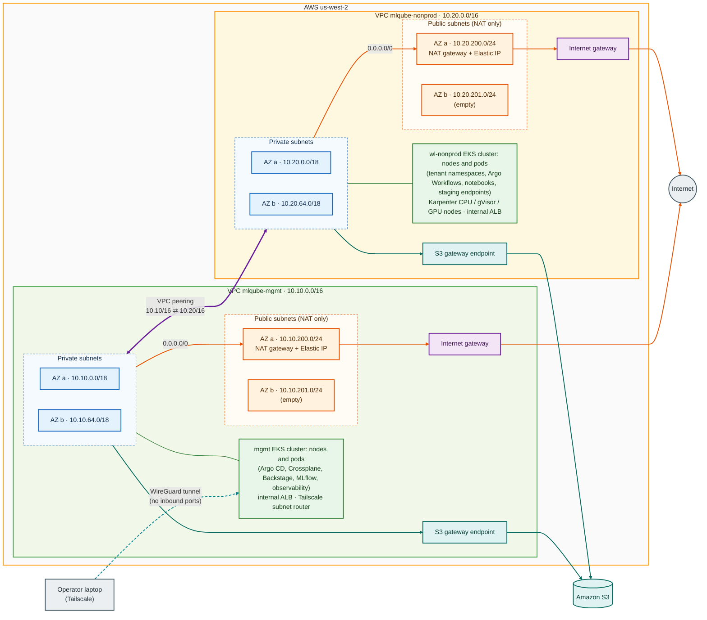

# Network layer

> Describes the code in [mlqube/infrastructure · `live/platform/network/`](https://github.com/mlqube/infrastructure/tree/main/live/platform/network). Docs for all repositories live here, in `mlqube/.github` ([index](../README.md)).

> Terraform root for the platform network: [`main.tf`](https://github.com/mlqube/infrastructure/blob/main/live/platform/network/main.tf), [`variables.tf`](https://github.com/mlqube/infrastructure/blob/main/live/platform/network/variables.tf), [`outputs.tf`](https://github.com/mlqube/infrastructure/blob/main/live/platform/network/outputs.tf); the reusable VPC module is in [`modules/network`](https://github.com/mlqube/infrastructure/tree/main/modules/network). Back to the [repository README](README.md).

The `network` layer creates one VPC per environment in **us-west-2**, each spread over two availability zones (AZ a and AZ b are the first two available zones in the account). Everything that runs MlQube lives in **private subnets**; the **public subnets only hold the NAT gateway**. The two VPCs are joined by **VPC peering**.

**Legend**

| Colour | Meaning |
|---|---|
| 🟧 Amber | Public subnets and the NAT gateway: the only part that reaches the internet; amber arrows are the outbound path |
| 🟦 Blue | Private subnets |
| 🟩 Green | EKS workloads: clusters, nodes and pods |
| 🟪 Purple | Internet gateways; the thick purple arrow is the VPC peering between mgmt and nonprod |
| Teal | S3 gateway endpoints and Amazon S3; the dashed teal arrow is the operator's Tailscale tunnel |
| ⬜ Grey | Outside AWS: the internet and the operator's laptop |

The VPC boxes use the same colours as the [MlQube architecture diagrams](../../architecture.md#enterprise-view): green for the management VPC, orange for non-prod.

## Address plan

Each `/16` is split into four `/18` quarters. Two quarters are the private subnets; the public `/24`s sit in the fourth quarter; the rest is kept free.

| VPC | Private, AZ a | Private, AZ b | Public, AZ a | Public, AZ b | Free for later |
|---|---|---|---|---|---|
| `mlqube-mgmt` | `10.10.0.0/18` | `10.10.64.0/18` | `10.10.200.0/24` | `10.10.201.0/24` | `10.10.128.0/18`, rest of `10.10.192.0/18` |
| `mlqube-nonprod` | `10.20.0.0/18` | `10.20.64.0/18` | `10.20.200.0/24` | `10.20.201.0/24` | `10.20.128.0/18`, rest of `10.20.192.0/18` |
| `mlqube-prod` (Phase 5) | reserved: `10.30.0.0/16` | | | | |

Each private subnet has about 16,000 addresses, because EKS gives every pod its own VPC IP address. The ranges don't overlap the operator's home network (`192.168.1.0/24`), WSL (`192.168.224.0/20`), Docker and kind (`172.16.0.0/12`) or Tailscale (`100.64.0.0/10`).

## What goes where

| Part of the network | Holds | Must not hold |
|---|---|---|
| **Public subnets** | The NAT gateway and its Elastic IP (one per VPC, in AZ a), attached to the internet gateway | Nodes, pods, databases, load balancers: nothing else (ingress is internal only, [ADR-0010](../../adr/0010-ingress.md)) |
| **Private subnets, `mlqube-mgmt`** | The management EKS cluster: its control-plane network interfaces, system node group and Karpenter nodes; platform pods (Argo CD, Crossplane, Backstage, MLflow, Prometheus, Grafana, Loki, OpenCost); the internal ALB for the portals; the Tailscale subnet router ([ADR-0011](../../adr/0011-private-access-reference-build.md)); later the RDS PostgreSQL for MLflow (Phase 4) | Tenant workloads ([ADR-0003](../../adr/0003-cluster-topology.md)) |
| **Private subnets, `mlqube-nonprod`** | The non-prod workload EKS cluster: Karpenter NodePools (CPU, gVisor CPU, GPU per tenant), tenant namespaces, Argo Workflows, notebooks, staging model endpoints, and its internal ALB | Platform control-plane services |
| **VPC peering** | Private traffic between the two VPCs: Argo CD and Crossplane managing the workload cluster, metrics and logs sent to central observability, operator access to the non-prod portals through the Tailscale router | Internet traffic (peering is not transitive: nonprod can't use mgmt's NAT gateway) |
| **S3 gateway endpoint** | Free path to S3 for container image layers (ECR), Terraform state and model artifacts, keeping that traffic off the NAT gateway | — |
| **Private hosted zone `mlqube.click`** | Attached to both VPCs; answers only from inside them (and from the operator's laptop through Tailscale split DNS). Holds the real names, e.g. `argocd.mlqube.click` → mgmt internal ALB, written by ExternalDNS. Same name as the public zone (split-horizon), which only holds certificate validation records ([base layer](base.md)) | Public names: nothing here is visible from the internet |
| **Interface endpoints** (off) | Optional private paths to ECR, STS and Secrets Manager; `enable_interface_endpoints = true` turns them on (about $0.08/hour per VPC) | — |

## Routing

| Route table | Destination | Target |
|---|---|---|
| Private (one per VPC, shared by both AZs) | `0.0.0.0/0` | NAT gateway in AZ a |
| | The other VPC's CIDR (`10.20.0.0/16` or `10.10.0.0/16`) | VPC peering connection |
| | S3 prefix list | S3 gateway endpoint |
| | Own VPC CIDR | local |
| Public (one per VPC) | `0.0.0.0/0` | Internet gateway |

A single NAT gateway per VPC keeps the reference build cheap. The trade-off: if AZ a has an outage, the private subnets lose outbound internet access until it recovers. A production setup would use one NAT gateway per AZ.

## Tailscale access (operator's laptop)

This layer also creates the **Tailscale subnet router** ([module](module-tailscale-router.md), [ADR-0011](../../adr/0011-private-access-reference-build.md)) in a private subnet of the mgmt VPC. It advertises `10.10.0.0/16` and `10.20.0.0/16` to the tailnet, so the operator's laptop reaches the private EKS API endpoints (and, later, the portals) through an encrypted tunnel. The clusters allow HTTPS to their private API from both VPC ranges for this. Turn it off with `enable_tailscale_router = false`.

### One-time setup (Tailscale admin console)

1. Tailscale account (free Personal plan); laptop signed in, with **Use Tailscale subnets** on.
2. **Access controls:** `tagOwners` with `tag:mlqube-router`, and `autoApprovers` routes `10.10.0.0/16` and `10.20.0.0/16` for that tag.
3. **DNS → Nameservers:** custom nameserver `10.10.0.2` restricted to `mlqube.click` (split DNS).

### Auth key (before the first network apply, then every 90 days)

1. Tailscale admin console → **Settings → Keys → Generate auth key**: **reusable**, **ephemeral**, **pre-approved**, tag `tag:mlqube-router`, expiry 90 days.
2. AWS console (us-west-2) → **Systems Manager → Parameter Store → Create parameter**:
   - Name: `/mlqube/tailscale/router-authkey`
   - Tier: **Standard** (free) · Type: **SecureString** · KMS key: `alias/aws/ssm` (default)
   - Value: the auth key
3. Never paste the key anywhere else (Git, chat, workflow logs). The router reads it at boot through its IAM role; it never appears in Terraform state.

To rotate: generate a new key, update the parameter's value, then recreate the router (destroy and apply the network, or replace just the instance).

### Check it

After `network` → `apply` (or `all`):

- Tailscale admin console → **Machines**: `mlqube-router`, tagged `tag:mlqube-router`, with subnet routes approved.
- On the laptop: `tailscale status` lists `mlqube-router`; `ping 10.10.0.2` answers.
- After a cluster apply: `aws eks update-kubeconfig --region us-west-2 --name mgmt --profile mlqube`, then `kubectl get nodes`.
