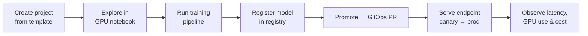

# MlQube

**A Kubernetes-native internal developer platform for ML and AI teams.**

MlQube lets ML engineers and data scientists **build, train, register and serve models** themselves, with no need to become Kubernetes experts. It is built from proven open-source projects and adds a thin layer for multi-tenancy, golden paths and cost visibility.

**[Why](https://github.com/mlqube/.github/blob/main/docs/why-an-ml-idp.md)** · **[Vision](https://github.com/mlqube/.github/blob/main/docs/vision.md)** · **[Architecture](https://github.com/mlqube/.github/blob/main/docs/architecture.md)** · **[Roadmap](https://github.com/mlqube/.github/blob/main/docs/roadmap.md)** · **[Decisions (ADRs)](https://github.com/mlqube/.github/blob/main/docs/adr/README.md)** · **[Platform docs](https://github.com/mlqube/.github/blob/main/docs/platform/README.md)** · **[What runs today](https://github.com/mlqube/.github/blob/main/README.md#what-runs-in-the-clusters)**

> **Status:** 🏗️ **Phase 1, the AWS foundation, is being built**, in the open. The reference platform (two EKS clusters, the GitOps hub and the base add-ons) is created from code for each test session and destroyed afterwards. Not ready for production. Progress: [Phase 1 plan](https://github.com/mlqube/.github/blob/main/docs/phase-1-plan.md) · [what runs in the clusters](https://github.com/mlqube/.github/blob/main/README.md#what-runs-in-the-clusters).

---

## Why MlQube?

ML teams lose a lot of time on infrastructure: GPU quotas, CUDA images, distributed training setup, serving stacks, model promotion and cost tracking. Platform teams end up rebuilding the same tooling again and again.

### Why does an organization need this?

- ⏱️ **Models get stuck before production.** Without standard paths, every deployment is a custom project, and AI initiatives stall after the pilot.
- 💸 **GPUs are expensive and poorly used.** Some sit idle while other teams wait; costs can't be attributed to teams or business units.
- 🔁 **Every team rebuilds the same stack.** Duplicated training, serving and CI tooling leads to inconsistent quality and wasted effort.
- 🛡️ **Governance gaps.** No clear lineage from data to deployed model; shadow infrastructure creates security and compliance risk.
- 🎫 **Platform teams become bottlenecks.** Engineers spend their time on tickets instead of improving the platform.

An ML platform turns infrastructure into **self-service golden paths**. ML teams ship faster, platform teams keep control, and finance can see where the money goes. 👉 [Read the full case](https://github.com/mlqube/.github/blob/main/docs/why-an-ml-idp.md)

MlQube aims to provide:

- 🧑‍💻 **Self-service workspaces.** GPU notebooks and IDEs with sensible images and quotas.
- 🐍 **Write Python, run it as a job.** ML code runs as Argo Workflows jobs and pipelines through a simple Python SDK, with no YAML.
- 🏋️ **Training at scale.** GPU jobs that queue fairly and scale to zero when idle.
- 📦 **Model registry and promotion.** Versioned models that move Dev → Staging → Prod through reviewed, auditable changes.
- 🚀 **Model serving.** Autoscaled endpoints for classic ML and LLMs, with canary rollouts.
- 🏢 **Business units as tenants.** Each business unit gets isolation, quotas and its own cost visibility.
- 🧭 **One front door.** A developer portal with templates, a model catalog and usage dashboards.

## The golden path

## Architecture at a glance

📐 **Main architecture diagram:** [full view, explained](https://github.com/mlqube/.github/blob/main/docs/architecture.md#5-full-view) · [SVG to zoom](https://github.com/mlqube/.github/blob/main/docs/diagrams/mlqube_5_enterprise.svg). The [architecture document](https://github.com/mlqube/.github/blob/main/docs/architecture.md#enterprise-view) walks through all six views step by step.

What is planned:

- ☁️ **AWS and Amazon EKS**, built with Terraform: one VPC per environment, private subnets only.
- 🕸️ **Hub-and-spoke clusters.** A **management cluster** runs the platform itself: Argo CD (GitOps hub), Crossplane (platform APIs), Backstage (portal), one shared MLflow and central observability. A **non-prod cluster** runs notebooks, training jobs and staging endpoints. A **prod cluster** serves models with KServe (vLLM for LLMs) and runs scheduled retraining.
- ⚡ **Elastic compute** with Karpenter: CPU, gVisor-sandboxed CPU, GPU dedicated per tenant (spot for training) and GPU inference.
- 🏢 **One tenant per business unit**, e.g. `retail-1042`, isolated with Capsule, quotas, default-deny network policies, Kyverno and a per-tenant IAM role.
- 🔐 **Single sign-on** through AWS IAM Identity Center and groups per tenant (`mlqube-<tenant>-admins`, `-developers`, `-viewers`); workloads never use static cloud keys.
- 🔄 **Model lifecycle:** train on a tenant GPU node → register in MLflow → test on a staging endpoint → promote through a GitOps PR → KServe canary in prod.
- 💰 **Governance and FinOps:** policies in every cluster, audit and lineage, and cost showback / chargeback per business unit with OpenCost.

| View | Shows |
|---|---|
| [1. High-level architecture](https://github.com/mlqube/.github/blob/main/docs/architecture.md#1-high-level-architecture) | The building blocks and how they relate |
| [2. Identity](https://github.com/mlqube/.github/blob/main/docs/architecture.md#2-identity-authentication-and-authorization) | How people are authenticated and authorized, and how workloads get cloud access |
| [3. Management cluster and shared services](https://github.com/mlqube/.github/blob/main/docs/architecture.md#3-management-cluster-and-shared-services) | What runs in the management cluster and how it uses shared AWS services |
| [4. Training, testing and serving](https://github.com/mlqube/.github/blob/main/docs/architecture.md#4-training-testing-and-serving) | One model's path from Python code to a canary in prod |
| [5. Full view](https://github.com/mlqube/.github/blob/main/docs/architecture.md#5-full-view) | All parts joined together |
| [6. GitOps hub and spoke](https://github.com/mlqube/.github/blob/main/docs/architecture.md#6-gitops-hub-and-spoke) | One Argo CD in the management cluster deploys to every cluster; workload clusters run no Argo CD |

## Built on open source

✅ = in the reference build today, linked to its page; the rest is planned ([roadmap](https://github.com/mlqube/.github/blob/main/docs/roadmap.md)).

| Area | Projects |
|---|---|
| Cloud & infrastructure | AWS: ✅ [Amazon EKS](https://github.com/mlqube/.github/blob/main/docs/platform/infrastructure/eks-mgmt.md), S3, ECR, RDS (first) · ✅ [Terraform](https://github.com/mlqube/.github/blob/main/docs/platform/infrastructure/README.md) |
| Cloud & networking | ✅ [AWS Load Balancer Controller](https://github.com/mlqube/.github/blob/main/docs/platform/gitops/aws-load-balancer-controller.md) (internal ALBs), ✅ [ExternalDNS](https://github.com/mlqube/.github/blob/main/docs/platform/gitops/external-dns.md) (private DNS) |
| Portal | Backstage |
| GitOps & platform APIs | ✅ [Argo CD](https://github.com/mlqube/.github/blob/main/docs/platform/gitops/README.md) (hub and spoke), Crossplane |
| Scheduling & quotas | ✅ [Karpenter](https://github.com/mlqube/.github/blob/main/docs/platform/gitops/karpenter.md) (CPU and GPU nodes), ✅ [NVIDIA device plugin](https://github.com/mlqube/.github/blob/main/docs/platform/gitops/karpenter.md#gpu-nodes-wl-nonprod), Kueue |
| ML jobs & pipelines | Argo Workflows + Hera (Python SDK) |
| Distributed training | Kubeflow Trainer, KubeRay |
| Tracking & registry | MLflow |
| Serving | KServe, vLLM, KEDA |
| Identity, tenancy & policy | ✅ AWS IAM Identity Center (SSO through [Dex](https://github.com/mlqube/.github/blob/main/docs/platform/gitops/dex.md)), ✅ [Kyverno](https://github.com/mlqube/.github/blob/main/docs/platform/gitops/kyverno.md), ✅ [External Secrets](https://github.com/mlqube/.github/blob/main/docs/platform/gitops/external-secrets.md), ✅ [cert-manager](https://github.com/mlqube/.github/blob/main/docs/platform/gitops/cert-manager.md), Capsule, gVisor |
| Observability & cost | ✅ [metrics-server](https://github.com/mlqube/.github/blob/main/docs/platform/gitops/metrics-server.md), Prometheus, Grafana, OpenTelemetry, OpenCost |

## Documentation map

| To ... | Read |
|---|---|
| **Understand why** | 💡 [Why an organization needs an ML platform](https://github.com/mlqube/.github/blob/main/docs/why-an-ml-idp.md) · 📖 [Vision](https://github.com/mlqube/.github/blob/main/docs/vision.md) |
| **See the design** | 🏗️ [Architecture](https://github.com/mlqube/.github/blob/main/docs/architecture.md) (six views, explained) · 🧩 [The MlQube glue](https://github.com/mlqube/.github/blob/main/docs/glue.md) (our code between the components) · 📝 [Architecture decision records](https://github.com/mlqube/.github/blob/main/docs/adr/README.md) |
| **Follow the plan** | 🗺️ [Roadmap](https://github.com/mlqube/.github/blob/main/docs/roadmap.md) · ✅ [Phase 1 plan](https://github.com/mlqube/.github/blob/main/docs/phase-1-plan.md) (what's done, what's next) · 🛤️ [Golden path v0 plan](https://github.com/mlqube/.github/blob/main/docs/golden-path-v0-plan.md) |
| **Work on it as an ML engineer** | 🧑‍💻 [The golden path](https://github.com/mlqube/.github/blob/main/docs/golden-path.md): feature branch → your own test run → merge → official run and registered model (planned) |
| **See what runs today** | 🧩 [What runs in the clusters](https://github.com/mlqube/.github/blob/main/README.md#what-runs-in-the-clusters): every component, its cluster, its status and its page |
| **Build and run it** | 🛠️ [Platform documentation](https://github.com/mlqube/.github/blob/main/docs/platform/README.md): [setup](https://github.com/mlqube/.github/blob/main/docs/platform/setup.md), [secrets](https://github.com/mlqube/.github/blob/main/docs/platform/secrets.md), [troubleshooting](https://github.com/mlqube/.github/blob/main/docs/platform/troubleshooting.md), and one page per Terraform layer and GitOps add-on |
| **Sign in** | 🔐 [Single sign-on through Dex](https://github.com/mlqube/.github/blob/main/docs/platform/gitops/dex.md) (with the sign-in flow diagram) |

Ideas and feedback are welcome. Please open an issue in this repository.
