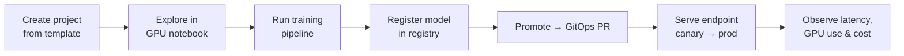

# MlQube

**A Kubernetes-native internal developer platform for ML and AI teams.**

MlQube lets ML engineers and data scientists **build, train, register and serve models** themselves, with no need to become Kubernetes experts. It is built from proven open-source projects and adds a thin layer for multi-tenancy, golden paths and cost visibility.

> **Status:** 🧭 Planning. We are designing the architecture in the open. Nothing here is ready for production yet.

---

## Why MlQube?

ML teams lose a lot of time on infrastructure: GPU quotas, CUDA images, distributed training setup, serving stacks, model promotion and cost tracking. Platform teams end up rebuilding the same tooling again and again.

### Why does an organization need this?

- ⏱️ **Models get stuck before production.** Without standard paths, every deployment is a custom project, and AI initiatives stall after the pilot.
- 💸 **GPUs are expensive and poorly used.** Some sit idle while other teams wait; costs can't be attributed to teams or customers.
- 🔁 **Every team rebuilds the same stack.** Duplicated training, serving and CI tooling leads to inconsistent quality and wasted effort.
- 🛡️ **Governance gaps.** No clear lineage from data to deployed model; shadow infrastructure creates security and compliance risk.
- 🎫 **Platform teams become bottlenecks.** Engineers spend their time on tickets instead of improving the platform.

An ML platform turns infrastructure into **self-service golden paths**. ML teams ship faster, platform teams keep control, and finance can see where the money goes. 👉 [Read the full case](https://github.com/mlqube/.github/blob/main/docs/why-an-ml-idp.md)

MlQube aims to provide:

- 🧑‍💻 **Self-service workspaces.** GPU notebooks and IDEs with sensible images and quotas.
- 🏋️ **Training at scale.** Distributed jobs and pipelines that queue fairly for GPUs and scale to zero when idle.
- 📦 **Model registry and promotion.** Versioned models that move Dev → Staging → Prod through reviewed, auditable changes.
- 🚀 **Model serving.** Autoscaled endpoints for classic ML and LLMs, with canary rollouts.
- 🏢 **Multi-tenancy from day one.** Isolation, quotas and per-tenant cost visibility.
- 🧭 **One front door.** A developer portal with templates, a model catalog and usage dashboards.

## The golden path

## Built on open source

| Area | Projects |
|---|---|
| Portal | Backstage |
| GitOps & platform APIs | Argo CD, Crossplane |
| Scheduling & quotas | Kueue, GPU Operator, Karpenter |
| Training | Kubeflow Trainer, KubeRay, Pipelines |
| Tracking & registry | MLflow |
| Serving | KServe, vLLM, KEDA |
| Security & policy | Keycloak, Kyverno, Cilium |
| Observability & cost | Prometheus, Grafana, OpenTelemetry, OpenCost |

## Learn more

- 💡 [Why an organization needs an ML platform](https://github.com/mlqube/.github/blob/main/docs/why-an-ml-idp.md)
- 📖 [Vision](https://github.com/mlqube/.github/blob/main/docs/vision.md)
- 🏗️ [Architecture](https://github.com/mlqube/.github/blob/main/docs/architecture.md)
- 🗺️ [Roadmap](https://github.com/mlqube/.github/blob/main/docs/roadmap.md)
- 📝 [Architecture decision records](https://github.com/mlqube/.github/tree/main/docs/adr)

Ideas and feedback are welcome. Please open an issue in this repository.
